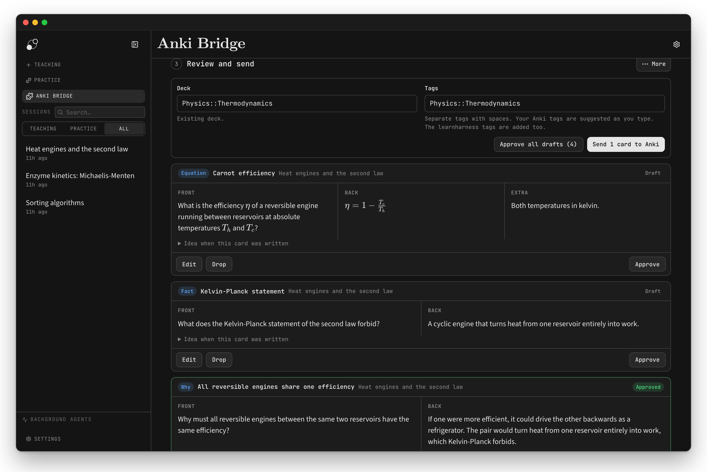
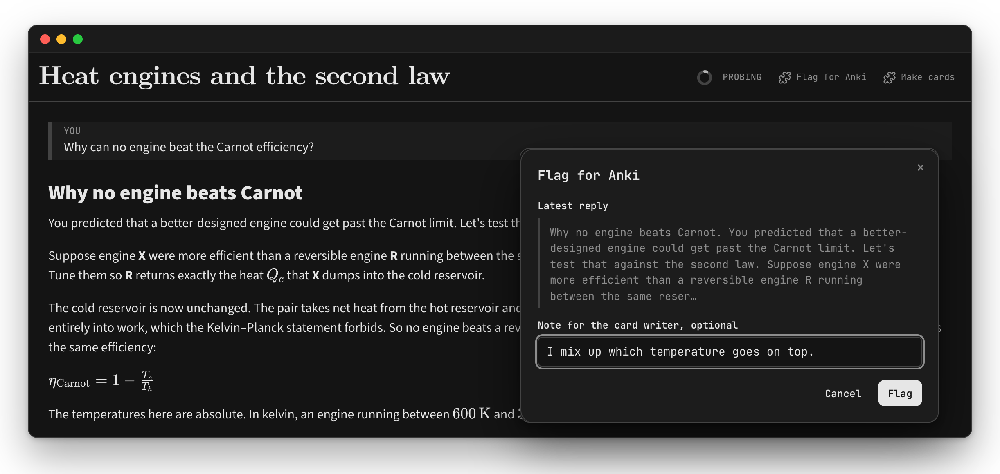
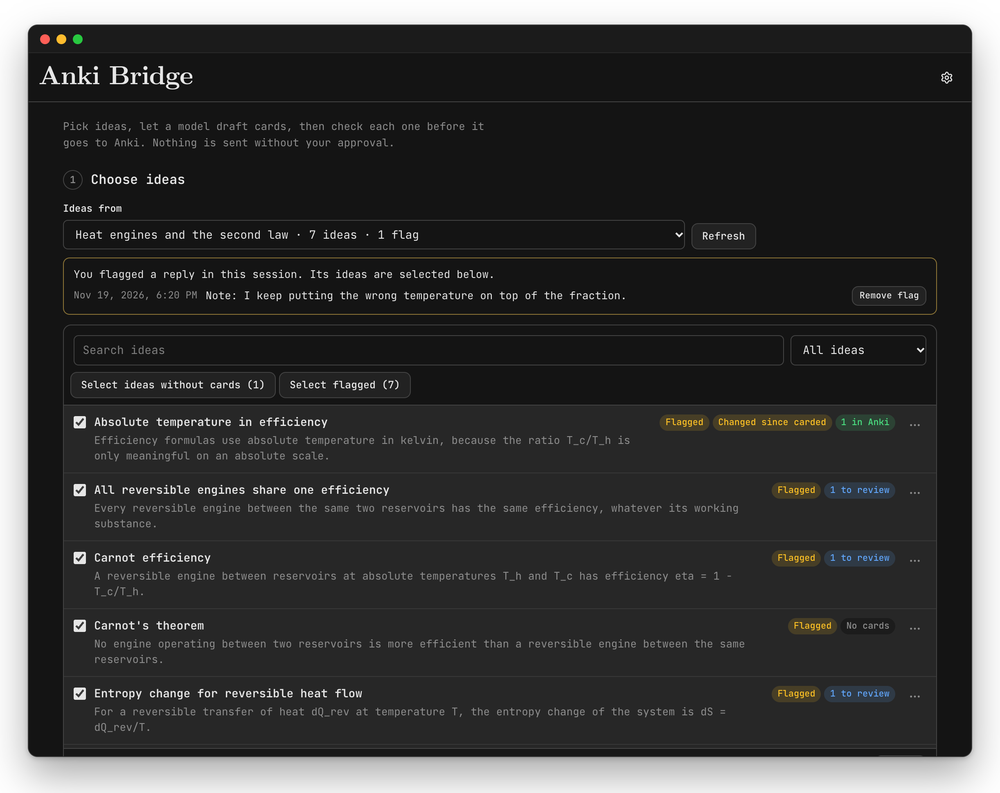
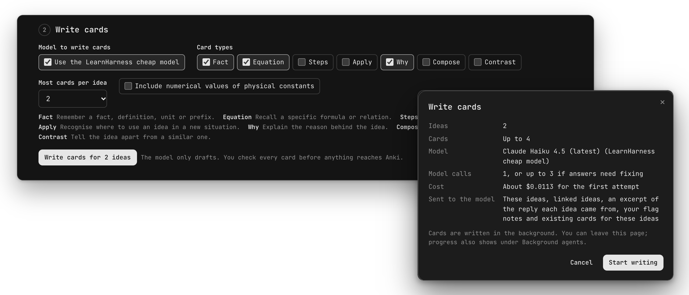
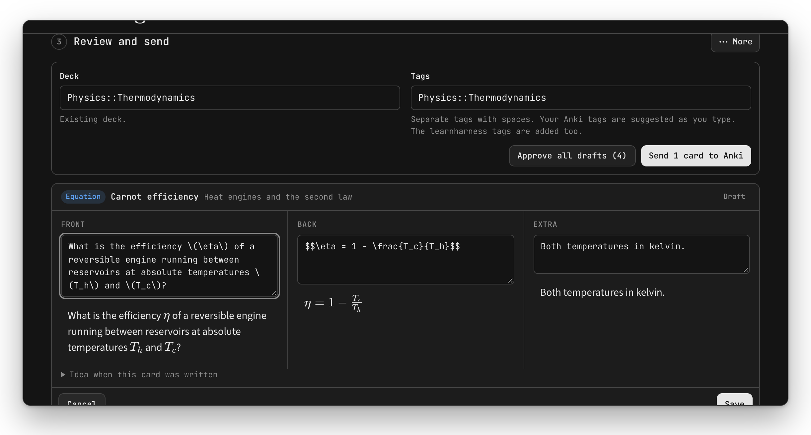
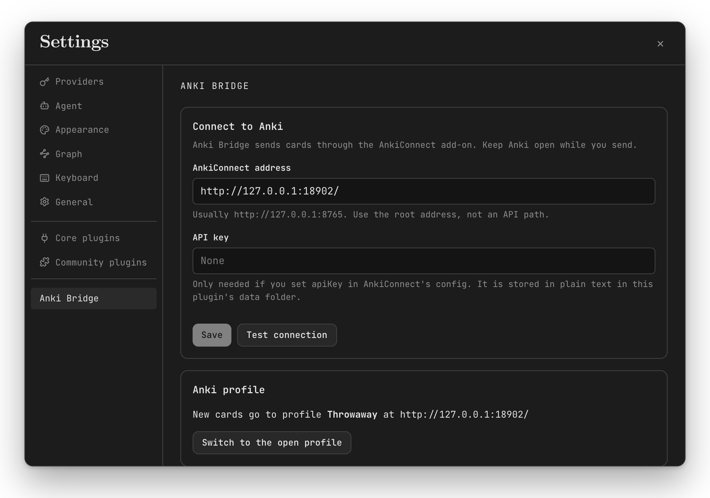

  <picture>
    <source media="(prefers-color-scheme: dark)" srcset="docs/images/readme/banner-dark.png">
    <source media="(prefers-color-scheme: light)" srcset="docs/images/readme/banner-light.png">
    
  </picture>

<strong>Turn what you learn in LearnHarness into Anki cards you have checked.</strong>

  <a href="#install">Install</a> ·
  <a href="#how-it-works">How it works</a> ·
  <a href="#card-types">Card types</a> ·
  <a href="#what-goes-where">What goes where</a> ·
  <a href="CHANGELOG.md">Changelog</a>

Anki Bridge is a community plugin for [LearnHarness](https://github.com/amosblomqvist/learnharness). It reads the ideas in your knowledge graph, has your model draft flashcards from them, and sends the ones you approve to [Anki](https://apps.ankiweb.net/) as new notes.

LearnHarness is good at building understanding. Anki is good at keeping it. The plugin connects the two in one direction and puts you in the middle. A model writes the drafts, you edit and approve them, and Anki schedules the reviews. Nothing reaches Anki until you press Send, and the plugin never edits or deletes a note that is already there.

## Why it works this way

**Cards start from your graph.** Each LearnHarness idea is a single claim, linked to the premises that support it and the teaching reply it came from. The model sees all of that, so a Why card can ask for the actual reasoning you were taught and a Contrast card can pick a real neighbouring idea.

**You review every card.** Model-written cards are often close but not quite right, and making or reworking your own cards helps you remember them better than studying a premade deck ([Pan et al., 2022](https://doi.org/10.1037/mac0000083)). The review screen is built for editing, with the source idea one click away and a live preview beside each field.

**It only ever adds.** Anki Bridge creates notes in its own note type and leaves existing notes, schedules and review history alone. If you change a card in Anki, your change stays.

**Maths and code survive the trip.** Cards use MathJax for equations and keep fenced code blocks with their indentation, both in the preview and in Anki.

## How it works

<picture>
  <source media="(prefers-color-scheme: dark)" srcset="docs/images/readme/how-it-works-dark.png">
  <source media="(prefers-color-scheme: light)" srcset="docs/images/readme/how-it-works-light.png">
  
</picture>

Open **Anki Bridge** from the LearnHarness sidebar. The page has three steps, top to bottom.

### Flag ideas while you learn

When a teaching reply covers something you want to keep, press **Flag for Anki** in the session's top bar, or Cmd+Shift+A (Ctrl+Shift+A on Windows and Linux). You can leave a note for the card writer, such as the mistake you made. The flag covers every idea LearnHarness extracts from that reply, and flagged ideas may get more cards than usual. **Make cards** in the same bar jumps straight to drafting for the current session.

### 1. Choose ideas

Pick a session, or the whole graph, and tick the ideas you want cards for. Each idea shows where it stands: flagged, no cards yet, drafts to review, already in Anki, or changed since you made its cards. One click selects every idea that has no cards, which is the quickest way to catch up on an old session. Ideas you never want cards for can be dismissed.

### 2. Write cards

Choose the card types and the most cards per idea, then press **Write cards**. The plugin uses your LearnHarness cheap model unless you pick another one. Before anything runs, you get the number of model calls, the most cards it can write, a cost estimate when the model has pricing, and a list of exactly what will be sent to the model.

Writing happens in the background, so you can keep learning. If you cancel, cards from finished batches are kept, and **Retry the rest** re-estimates only the batches that failed.

### 3. Review and send

Every draft shows its front, back and optional extra field with maths and code rendered. Open **Idea when this card was written** to compare a card with its source. Edit, drop or approve cards one at a time, or approve all drafts once you have read them. Long cards get a gentle warning, not a block.

Pick a deck (or type a new one), check the tags and press **Send**. The tags field suggests tags from your Anki collection and fills in a template you set once. A green panel confirms what was sent, where, and with which tags, and **Show in Anki** opens the new notes in Anki's browser.

## Card types

<picture>
  <source media="(prefers-color-scheme: dark)" srcset="docs/images/readme/card-types-dark.png">
  <source media="(prefers-color-scheme: light)" srcset="docs/images/readme/card-types-light.png">
  
</picture>

| Type | What it asks you to do | Default |
| --- | --- | --- |
| Fact | Remember a fact, definition, unit or prefix | On |
| Equation | Recall a specific formula or relation | On |
| Steps | Recall the steps of a method | Off |
| Apply | Recognise where to use an idea in a new situation | Off |
| Why | Explain the reason behind the idea | Off |
| Compose | Combine linked ideas to reach this one | Off |
| Contrast | Tell the idea apart from a similar one | Off |

The model writes only types that fit an idea. Why and Compose need a reasoning chain that ends in the idea, and Contrast needs a related idea to compare with. An idea can also get no card at all if the model judges it not worth one, and it says why. Numerical values of physical constants are left out of answers unless you turn them on.

## Install

> [!NOTE]
> Anki Bridge has no public release yet. Version 0.7.2 is the current build for personal use. Until a release is published, build the install zip from source as described below.

### What you need

- [LearnHarness](https://github.com/amosblomqvist/learnharness) 0.6.1 or later, with community plugins (plugin API v1). Testing so far has been on 0.6.1.
- Anki Desktop with the [AnkiConnect](https://git.sr.ht/~foosoft/anki-connect) add-on, running while you send. Tested with Anki 26.08.1 and AnkiConnect 26.10.11.0 and 26.11.15.0. AnkiConnect builds without `getActiveProfile` are refused, because the plugin uses it to check it is writing to the right profile.
- A model set up in LearnHarness. Choosing ideas and estimating cost make no model calls. Writing cards uses your provider's quota.

### Steps

1. Get `anki-bridge-v0.7.2.zip`. To build it, run `npm ci` and then `npm run package:plugin` in this repository with Node.js 23.6 or later.
2. In LearnHarness, open **Settings → Community plugins** and copy the plugins folder path. Quit LearnHarness.
3. Unzip the archive and move the `anki-bridge` folder into the plugins folder, so the manifest ends up at `anki-bridge/dist/manifest.json`.
4. Start LearnHarness, enable **Anki Bridge** under Community plugins, and open it from the sidebar.

To upgrade later, replace only `anki-bridge/dist/` and keep `anki-bridge/data/`, which holds your drafts, flags and send history. The [install guide](docs/install.md) has the full upgrade, rollback and troubleshooting steps.

> [!WARNING]
> Community plugins run local code with the same access as LearnHarness. Only install a build you trust.

### Connect to Anki

Open Anki on the profile you want cards in. In **Settings → Anki Bridge**, enter your AnkiConnect address (usually `http://127.0.0.1:8765`) and press **Test connection**. Then choose **Use the open profile**. From then on, the plugin checks the profile before every send and stops if a different one is open.

  

## What goes where

| | What | When |
| --- | --- | --- |
| To your model | The chosen ideas, their linked ideas, an excerpt of the reply each idea came from, your flag notes and any existing cards for those ideas | Only after you confirm the estimate |
| To Anki | Approved cards as new notes in the note type `LearnHarness Basic`, with fields Front, Back, Extra, Source, LH_ID and LH_Node | Only when you press Send |
| Read from Anki | Connection, active profile, deck names, tags, the note type, and whether sent notes still exist | When you open the page, send, or run a check |
| Never touched | Existing notes, scheduling and review history | Never |

Every note gets the tags `learnharness` and `learnharness::kind::<type>`, so you can find or filter plugin cards in Anki. Drafts, flags and send records stay in the plugin's own data folder inside LearnHarness. Your LearnHarness graph and sessions are read, never changed.

## Limitations

- Cards are Basic front-and-back notes. Cloze, reversed and type-in cards are not supported.
- Images and Mermaid diagrams cannot go in cards.
- Content goes one way. Review results from Anki do not come back to LearnHarness.
- Card quality depends on your model. Check every draft. A full card-quality benchmark across subjects has not been run yet.
- Anki Desktop must be open with AnkiConnect running. Don't switch Anki profiles during a send, because AnkiConnect cannot check the profile and write in a single step.
- An optional AnkiConnect API key is stored in plain text in the plugin's data folder.

## Roadmap

These are proposals and open pull requests. None of them is merged.

- Simpler drafting controls: fewer card-type choices on the Write step and a plainer model picker ([#40](https://github.com/Singh-Mehtab/learnharness-anki-bridge/pull/40)).
- Topics to revisit, drawn from your Anki reviews ([#41](https://github.com/Singh-Mehtab/learnharness-anki-bridge/pull/41)).
- Export approved cards as an `.apkg` file, for when AnkiConnect is not an option ([#42](https://github.com/Singh-Mehtab/learnharness-anki-bridge/pull/42)).
- A first public release.

## Questions

**Does this replace the built-in Flashcards plugin?** No. Flashcards schedules reviews inside LearnHarness. Anki Bridge hands cards to Anki and lets Anki schedule them. The two share no data and can both be enabled.

**What happens if I edit a card in Anki?** Your edit stays. The plugin never updates a note after sending it. If you regenerate cards for an idea, the model sees the existing ones and tries new angles rather than repeating them.

**What if a send is interrupted?** The plugin records each send before it starts. After a crash or restart, **Check unconfirmed sends** in the More menu finds out which notes reached Anki, so nothing is sent twice.

**Is it affiliated with Anki or LearnHarness?** No. It is an unofficial community plugin.

## Development

See [docs/development.md](docs/development.md) for setup, tests and the card-quality bench, and [CHANGELOG.md](CHANGELOG.md) for version history. The README images are made from synthetic data. Their sources are in [docs/images/readme/src](docs/images/readme/src).

## Credits and license

The card writer adapts card-kind and prompt rules from [Twig](https://github.com/amoghu1s1/twig) and from LearnHarness's core Flashcards plugin, both AGPL-3.0. The development SDK types and local install script come from LearnHarness. See [THIRD_PARTY_NOTICES.md](THIRD_PARTY_NOTICES.md).

Anki Bridge is licensed under [AGPL-3.0](LICENSE).
