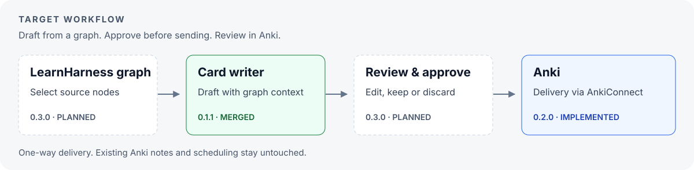

# Anki Bridge

A LearnHarness community plugin in development. The goal is to draft cards from your knowledge graph, let you edit and approve them, and send them to Anki through AnkiConnect. Anki keeps responsibility for reviews and scheduling.

**Current merged version: 0.1.1.** The shared card writer and quality bench are merged. The Anki connection and delivery UI are implemented in [PR #2](https://github.com/Singh-Mehtab/learnharness-anki-bridge/pull/2), which is still open. There is no public release or end-to-end graph-to-Anki plugin on `main` yet.



The diagram shows the intended workflow. Graph selection and in-app draft review are planned; the current delivery UI accepts hand-written cards.

## What's done

| Version | Status | Work completed |
| --- | --- | --- |
| 0.1.0 | Merged | Shared writer input builder, graph context, batching, prompts, result schema and validation. Sonnet bench with real QM nodes and labelled synthetic fixtures. Local browser scoring, JSON results and per-run reports. |
| 0.1.1 | Merged in [PR #1](https://github.com/Singh-Mehtab/learnharness-anki-bridge/pull/1) | Multiline code support, stronger accuracy and answer-leak guidance, soft word targets, a hard generation-call budget, and separate automated/human scoring. 22 tests, typecheck and browser checks passed. Sol approved the code. |
| 0.2.0 | Implemented and tested; [PR #2](https://github.com/Singh-Mehtab/learnharness-anki-bridge/pull/2) open | Hand-written-card UI, connection/profile pairing, owned Basic note type, approval, durable delivery state, interrupted-send recovery, presence checks and Show in Anki. 66 tests and build/typecheck passed, with scratch LearnHarness and real AnkiConnect integration tests. PR review and user acceptance are pending; packaged Electron behavior is unverified. |

### Card writer

- Core kinds: recall, why, compose and discriminate. Why/compose need supporting chains; discriminate needs a relevant neighbour.
- Up to two cards per node, not a quota. Prefer one useful card over a near-duplicate pair.
- Soft targets of 30 front words and 15 back words. Correctness and necessary assumptions take priority.
- Maths, inline code and multiline fenced code. Images and Mermaid are unsupported in cards.
- Deterministic checks for structure, allowed kinds, duplicates and surface answer leaks. These checks cannot guarantee factual accuracy or detect every semantic leak.

Mini-problem and spot-the-mistake kinds remain experimental and off by default.

### Quality evidence and limits

The original core bench failed the zero-answer-leak criterion. The 0.1.1 follow-up produced 32 cards from previously unused QM target nodes in the same lecture. Sol provisionally kept 24 of 32 as-is or with small edits, with no flagged leaks or factual errors among the kept cards. Five rejected cards had factual-error flags.

That is a partial result, **not a full benchmark pass**. Claude's quota stopped both synthetic-subject batches. The fixtures are hand-written and cleaner than real extraction output; the QM sample is not from an independent lecture. Human spot-checks and model scores remain separate.

Additional card-quality validation is deferred until before public release. No automatic rerun is scheduled. See the [bench guide](bench/README.md) and [0.1.1 closeout](bench/0.1.1-closeout.md) for methods and limitations. Private graph data, generated cards and per-card scores are not committed.

## Development preview


Actual 0.2.0 integration-test screenshot, not a mockup. It uses synthetic cards, an empty scratch LearnHarness environment and a throwaway Anki profile. This UI belongs to the pending PR, not the merged 0.1.1 package. It demonstrates manual delivery, not graph-based generation.

The 0.2.0 tests used LearnHarness 0.6.1, Anki 26.08.1 and AnkiConnect builds 26.10.11.0 and 26.11.15.0. Older builds without active-profile identity support are not supported. [Verification details in PR #2](https://github.com/Singh-Mehtab/learnharness-anki-bridge/blob/feat/0.2.0-anki-plumbing/docs/0.2.0-verification.md).

## Development setup

For the merged writer and bench, use Node.js 23.6 or newer, matching `package.json`:

```sh
npm ci
npm test
npm run typecheck
```

Inspect batch packing without making model calls:

```sh
npm run bench:run -- --dry-run
```

Dry runs still need the selected fixture sets. The default includes a private `qm` set; [prepare your own fixtures or select synthetic sets](bench/README.md). The following works with the committed fixtures only:

```sh
npm run bench:run -- --dry-run --sets humanities,programming
```

Actual generation uses the Claude Code CLI and requires authentication. It consumes your Claude subscription quota. The tests and dry runs make no model calls.

Do not test delivery against a personal Anki collection. Use a throwaway profile and scratch LearnHarness data. A normal plugin installation guide will come with the public release; the current `main` branch is a writer/bench workspace.

## Next versions

| Version | Planned scope |
| --- | --- |
| 0.3.0 | Graph-node selection, model drafting and editable card approval inside LearnHarness. |
| 0.4.0 | Session workflow and session-based card generation. |
| 0.5.0 | Card coverage and no-cards filtering. |
| 0.6.0 | First public release, after validation and explicit publication approval. |

These are plans, not shipped features or promised dates. The design is one-way and approval-first: the plugin must not update or delete existing Anki notes or change scheduling. Anki edits win.

## Keeping this page current

Every version change, including patches, must update this README in the same PR. Keep the current version, completed work, test evidence, limitations and screenshots accurate. Mark unmerged or planned work explicitly. The repository instructions in [`AGENTS.md`](AGENTS.md) enforce this rule for coding agents.

## License and acknowledgements

[AGPL-3.0-only](LICENSE).

The writer adapts card-design guidance from [LearnHarness core Flashcards](https://github.com/amosblomqvist/learnharness/tree/v0.6.1/plugins/flashcards) and [Twig](https://github.com/amoghu1s1/twig), under AGPL-3.0. Anki Bridge uses a different approval-first, one-way delivery design. [AnkiConnect](https://git.sr.ht/~foosoft/anki-connect) provides the local Anki API.
