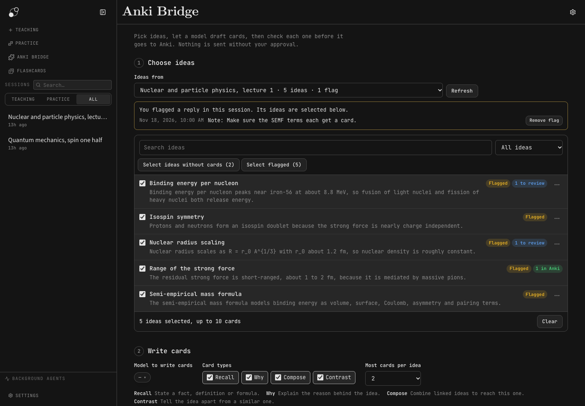

# Anki Bridge

An unofficial LearnHarness community plugin in development. The goal is to draft cards from your knowledge graph, let you edit and approve them, and send them to Anki through AnkiConnect. Delivery is one-way; Anki keeps responsibility for reviews and scheduling. This project is not affiliated with Anki or LearnHarness.

**Version 0.7.0 is a personal-use candidate.** It redesigns the plugin to match the rest of LearnHarness, using the app's own buttons, borders and theme colours. The page is now three numbered steps, and connection upkeep lives in settings. There is no public release yet. See the [install guide](docs/install.md) for the install zip, setup and upgrades.


Pick ideas from one teaching session or the whole graph, let a model draft cards in the background, then check, tag and send each card. Coverage labels, flags and reversible dismissals from earlier versions carry over.

## What's done

| Version | Status | Work completed |
| --- | --- | --- |
| 0.1.0 | Merged | Shared writer input builder, graph context, batching, prompts, result schema and validation. Sonnet bench with real QM nodes and labelled synthetic fixtures. Local browser scoring, JSON results and per-run reports. |
| 0.1.1 | Merged in [PR #1](https://github.com/Singh-Mehtab/learnharness-anki-bridge/pull/1) | Multiline code support, stronger accuracy and answer-leak guidance, soft word targets, a hard generation-call budget, and separate automated/human scoring. 22 tests, typecheck and browser checks passed. Sol approved the code. |
| 0.2.0 | Merged in [PR #2](https://github.com/Singh-Mehtab/learnharness-anki-bridge/pull/2) | Connection/profile pairing, owned Basic note type, approval, durable delivery, interrupted-send recovery, presence checks and Show in Anki. Final merged head passed 77 tests, build and typecheck. Real AnkiConnect and scratch LearnHarness checks predate the final renderer fixes and main merge. |
| 0.3.0 | Merged in [PR #5](https://github.com/Singh-Mehtab/learnharness-anki-bridge/pull/5) (`e88f89d`) | Native graph and model pickers, configurable card kinds and cap, confirmed preflight, worker generation, source-aware editable review with previews, bulk approval/send, dropping cards and generation recovery. 100 tests, typecheck and build pass. A scratch LearnHarness run with a local stub model passed seven end-to-end checks and a restart-during-generation check. Not yet tested with a real model in the app, or by sending generated cards to Anki. See [verification and limits](docs/0.3.0-verification.md). |
| 0.4.0 | Merged in [PR #4](https://github.com/Singh-Mehtab/learnharness-anki-bridge/pull/4) | Flag for Anki and Make cards in the teaching top bar, flag notes passed to the writer, waiting-for-extraction status, and session node selection that feeds the draft panel. 137 tests, typecheck and build pass. Both Sol reviewers approved after three rounds each. Earlier scratch LearnHarness checks passed 17 session checks and 9 integrated drafting checks with a local stub. No real model or Anki calls were made. See [verification and limits](docs/0.4.0-verification.md). |
| 0.5.0 | Merged in [PR #7](https://github.com/Singh-Mehtab/learnharness-anki-bridge/pull/7) | Shared destination-aware coverage, changed/missing-source warnings, dismiss/restore, coverage-aware node lists and no-cards backfill. State schema 4 preserves older cards, flags and generation recovery data. See [verification and limits](docs/0.5.0-verification.md). |
| 0.6.0 | Merged in [PR #9](https://github.com/Singh-Mehtab/learnharness-anki-bridge/pull/9) | First install zip and upgrade instructions. See [verification and limits](docs/0.6.0-verification.md). |
| 0.6.1 | Merged for personal use | Destination checks, refresh and recovery fixes, collapsed sent history, and Anki field previews. See [verification and limits](docs/0.6.1-verification.md). |
| 0.7.0 | Merged for personal use | Redesign that fixes the 18 interface issues filed after 0.6.1 (#11 to #28). Three numbered steps, one idea list scoped to a session or the graph, background writing with a single progress line, a card editor with Front, Back and Extra side by side, a deck field that checks names, and a tag template. The writer prompt now asks for MathJax on every variable and prefers display maths. 196 tests, typecheck and build pass. See [verification and limits](docs/0.7.0-verification.md). |

### Card writer

- Core kinds: recall, why, compose and discriminate. Why/compose need supporting chains; discriminate needs a relevant neighbour.
- A cap of one to four cards per node, two by default. The cap is a maximum, not a quota. The writer prefers one useful card over a near-duplicate pair.
- Soft targets of 30 front words and 15 back words. Correctness and necessary assumptions take priority.
- Maths, inline code and multiline fenced code. Images and Mermaid are unsupported in cards.
- Deterministic checks for structure, allowed kinds, duplicates and surface answer leaks. These checks cannot guarantee factual accuracy or detect every semantic leak.

Mini-problem and spot-the-mistake kinds remain experimental and off by default.

### Quality evidence and limits

The original core bench failed the zero-answer-leak criterion. The 0.1.1 follow-up produced 32 cards from previously unused QM target nodes in the same lecture. Sol provisionally kept 24 of 32 as-is or with small edits, with no flagged leaks or factual errors among the kept cards. Five rejected cards had factual-error flags.

That is a partial result, **not a full benchmark pass**. Claude's quota stopped both synthetic-subject batches. The fixtures are hand-written and cleaner than real extraction output; the QM sample is not from an independent lecture. Human spot-checks and model scores remain separate.

Additional card-quality validation is deferred until before public release. No automatic rerun is scheduled. See the [bench guide](bench/README.md) and [0.1.1 closeout](bench/0.1.1-closeout.md) for methods and limitations. Private graph data, generated cards and per-card scores are not committed.

## Using Anki Bridge (0.7.0)

The page has three numbered steps. Settings hold the AnkiConnect address, the Anki profile, tags and note type repairs.



1. **Choose ideas.** "Ideas from" picks one teaching session or all sessions. The list below shows only those ideas, in a bordered box with search, a "Without cards" filter and a count of the cards you could get. Each idea is labelled Flagged, To review, In Anki, Not carding or No cards. "Select ideas without cards" ticks every visible idea that has no cards. In a session, flagged ideas start ticked. The menu on each idea lets you stop carding it, make cards for it again, or jump to its cards in step 3.
2. **Write cards.** Choose the model and card types, and set the most cards per idea. Recall states a fact, Why explains a reason, Compose combines linked ideas, and Contrast separates the idea from a similar one (stored as `discriminate`). Write cards opens a dialog with the idea count, card limit, model calls and any cost estimate. Nothing runs until you press Start writing. Writing runs in the background and shows one progress line with Cancel. When a run ends, one summary offers Retry the rest and Dismiss. Cancelled ideas can be selected again straight away.
3. **Review and send.** Each card shows Front, Back and Extra side by side with maths rendered. Edit swaps in text boxes with a live preview. Approve cards one at a time or all together. The deck field suggests your Anki decks and says whether a name already exists or will be created. Tags start from your template and can be changed before each send. Sending without a deck or profile shows an error. The More menu holds Write a card by hand, Check unconfirmed sends, presence checks, Show in Anki and Drop all unsent cards.


Screenshots come from a scratch LearnHarness host with synthetic sessions and a fake AnkiConnect. They show the interface, not real card quality. Also see the [estimate dialog](docs/images/0.7.0-write-dialog.png), [editing a card](docs/images/0.7.0-edit.png), [a failed run](docs/images/0.7.0-failed-run.png), [settings](docs/images/0.7.0-settings.png), [tags and note type settings](docs/images/0.7.0-settings-tags.png), [the flag dialog](docs/images/0.7.0-flag-dialog.png) and [the light theme](docs/images/0.7.0-light.png). The [0.6.1 page](docs/images/0.6.1-before.png) is kept for comparison.

### Tags

Set "Tags for new cards" in settings. Separate tags with spaces. `{deck}` becomes the deck name with spaces replaced by underscores, so the template `{deck}::Lecture_01` with the deck `Year 3::Nuclear Physics` gives `Year_3::Nuclear_Physics::Lecture_01`. The send bar shows the result, and any change you make there applies to that send. The `learnharness` and card-type tags are on by default and can be turned off.

### Session flags

In a teaching session, Flag for Anki in the top bar marks the teacher's latest reply for cards. A click opens a dialog with a plain-text preview of the reply and an optional note such as "I got the sign wrong". The card writer receives the note with that reply's ideas. The shortcut, `Cmd/Ctrl+Shift+A` by default, flags straight away and offers the note in a short confirmation. A flag covers every idea LearnHarness extracted from that reply.

LearnHarness extracts ideas after a reply settles and doesn't announce when it finishes. Until then the flag shows that extraction is still running, and the page re-checks when extraction activity changes. Make cards in the top bar opens Anki Bridge scoped to that session with its flagged ideas ticked. Flags in other sessions are listed under step 1 and open their session.

### Coverage and backfill

Coverage counts cards sent to the paired URL and profile across all decks. Cards sent to another profile get their own label. These are saved records, not a live presence check. A note deleted in Anki stays deleted and does not return to backfill.

Selecting ideas without cards keeps backfill intent through estimates, confirmation and retries, including after restart. If an idea gains coverage first, the backend rejects that backfill target. Tick it yourself to ask for another angle. Not carding an idea applies to its current statement across sessions and profiles, never drops drafts and never changes Anki. A changed statement ends the old dismissal and shows a warning. Both views keep a 1,000-idea selection limit.

If a list read fails, the last rows stay visible and marked out of date, and selection is disabled until Refresh succeeds. Ideas missing from the current graph read appear in a collapsed history section with their cards kept.

## Earlier verification

The 0.2.0 tests used LearnHarness 0.6.1, Anki 26.08.1 and AnkiConnect builds 26.10.11.0 and 26.11.15.0. They covered note type creation and repair, duplicate rejection, profile mismatches, Show in Anki, and recovery after killing the bridge immediately after a real `addNote`. See [0.2.0 verification](docs/0.2.0-verification.md) and [0.3.0 verification](docs/0.3.0-verification.md).

## Development setup

Use Node.js 23.6 or newer, npm, and Info-ZIP-compatible `zip` and `unzip` for the packaging tests. The tests need `unzip -Z1`, which BusyBox `unzip` does not support.

```sh
npm ci
npm test
npm run typecheck
npm run build
```

Inspect batch packing without making model calls:

```sh
npm run bench:run -- --dry-run
```

Dry runs still need the selected fixture sets. The default includes a private `qm` set; [prepare your own fixtures or select synthetic sets](bench/README.md). The following works with the committed fixtures only:

```sh
npm run bench:run -- --dry-run --sets humanities,programming
```

The bench uses the authenticated Claude Code CLI. In-app drafting uses your explicitly selected LearnHarness model and its provider account, including subscription quota on Claude Code routes. The automated tests and dry runs make no model calls.

### Try the development workflow

For development tests, use a throwaway Anki profile and a LearnHarness checkout with scratch `LH_DATA_DIR` and `LH_AUTH_FILE` paths. Generation consumes your selected provider's quota only after you confirm the preflight.

1. Install [AnkiConnect](https://git.sr.ht/~foosoft/anki-connect) and open the throwaway Anki profile. The tested AnkiConnect builds require Anki 26.08 or later. The bridge also requires `getActiveProfile`; older builds without it are refused.
2. Install the built plugin in the scratch app's plugins directory, shown under Settings → Community plugins:

   ```sh
   npm run install:local -- "/absolute/path/to/scratch/plugins"
   ```

   The installer replaces `anki-bridge/dist/` and preserves its sibling `data/`. Discovery leaves the plugin disabled. Enable it in settings; restart LearnHarness after changing already-loaded plugin code.
3. Open the Anki Bridge settings. Save the AnkiConnect address and optional API key, then test the connection. The default is `http://127.0.0.1:8765`; check your local port first because another service may use it. With Anki open on the throwaway profile, choose Use the open profile.
4. Open Anki Bridge from the sidebar and choose ideas in step 1. In step 2, select a configured model, card types and the most cards per idea, then press Write cards. The dialog shows the idea count, card limit, model calls and a dollar estimate when the catalog has pricing. Estimating calls no model. Start writing runs it in the background; you can leave the page. Cancelling keeps cards from finished batches.
5. Review each card. The collapsed Source idea shows the statement captured at drafting. Edit and save as needed; editing an approved card returns it to draft. Length warnings are advisory. Drop unwanted cards, then approve cards one at a time or all together. No generated card is approved automatically.
6. Choose an existing or new deck, check the tags and send approved cards. Check presence or use Show in Anki. URL or profile mismatches block sends and reconciliation; do not switch profiles during a send, since AnkiConnect cannot make a profile check and write atomic.

Completed worker results are applied at most once. Retry the rest offers a new estimate for unsuccessful batches; it does not regenerate successful ones. Source changes and missing ideas are shown without changing Anki notes. Write a card by hand is in the More menu.

The bridge never updates or deletes existing Anki notes or their review history. Field repair and styling replacement are separate actions; styling replacement can overwrite template edits after confirmation. Close affected Anki editors before either operation.

The optional API key is stored in plain text in the plugin's `data/` directory. Keep it private, use loopback and a trusted local AnkiConnect service, and never distribute `data/`. A remote HTTP endpoint can expose both the key and card content. The saved key is not displayed. A blank key input keeps it only while the URL stays the same; saving a different URL clears it, and Remove saved key removes it.

The opt-in [live integration test](docs/0.2.0-verification.md) requires an isolated profile named `Anki Bridge Test`, leaves notes in that collection, and refuses ports 8765 and 8766. It does not start or stop Anki. The core Flashcards plugin is independent and can remain enabled.

## Before public release

The full card-quality benchmark is still open. A personal trial can find setup and workflow problems, but it does not close that quality check. Public availability and community announcements are separate decisions.

## Keeping this page current

Every version change, including patches, must update this README in the same PR. Keep the current version, completed work, test evidence, limitations and screenshots accurate. Mark unmerged or planned work explicitly. Repository instructions enforce this rule for coding agents.

## License and acknowledgements

[AGPL-3.0-only](LICENSE).

The writer adapts card-design guidance from [LearnHarness core Flashcards](https://github.com/amosblomqvist/learnharness/tree/v0.6.1/plugins/flashcards) and [Twig](https://github.com/amoghu1s1/twig), under AGPL-3.0. Anki Bridge uses a different approval-first, one-way delivery design. [AnkiConnect](https://git.sr.ht/~foosoft/anki-connect) provides the local Anki API.
