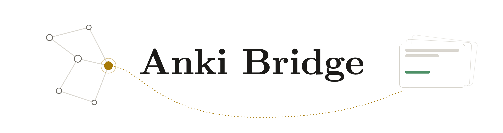
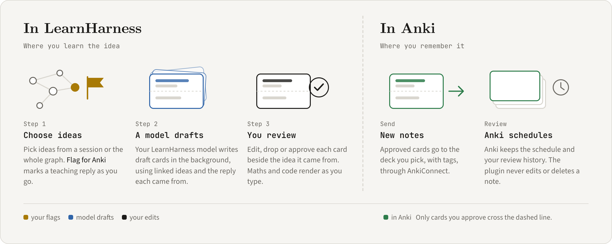
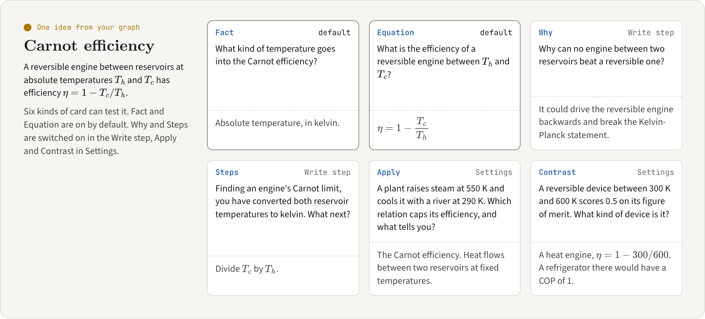
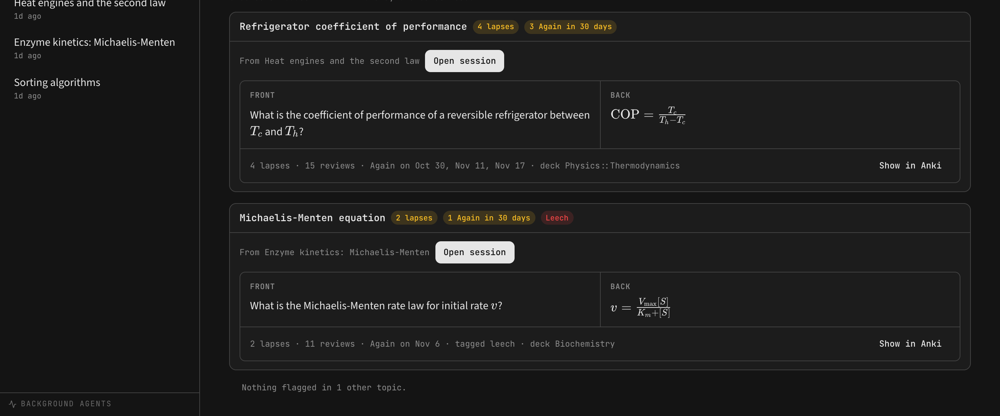

<h1 align="center">
  <picture>
    <source media="(prefers-color-scheme: dark)" srcset="docs/images/readme/banner-dark.png">
    <source media="(prefers-color-scheme: light)" srcset="docs/images/readme/banner-light.png">
    
  </picture>
</h1>

<strong>Make Anki cards from what you learn in LearnHarness.</strong>

  <a href="#install">Install</a> ·
  <a href="#how-it-works">How it works</a> ·
  <a href="#card-types">Card types</a> ·
  <a href="#check-anki-reviews">Check Anki reviews</a> ·
  <a href="#what-goes-where">What goes where</a> ·
  <a href="CHANGELOG.md">Changelog</a>

Source version 0.9.1 · <a href="https://github.com/Singh-Mehtab/learnharness-anki-bridge/releases/latest">Download</a> · AGPL-3.0

Anki Bridge is a community plugin for [LearnHarness](https://github.com/amosblomqvist/learnharness). Your model drafts flashcards from the ideas in your knowledge graph. You edit and approve each draft, then send it to [Anki](https://apps.ankiweb.net/) or download it as a package. Anki schedules the reviews.

<picture>
  <source media="(prefers-color-scheme: dark)" srcset="docs/images/readme/how-it-works-dark.png">
  <source media="(prefers-color-scheme: light)" srcset="docs/images/readme/how-it-works-light.png">
  
</picture>

## How it works

### Flag replies while you learn

When a teaching reply covers something you want to keep, press **Flag for Anki** in the session's top bar. This flags the latest finished reply and every idea LearnHarness extracts from it. You can add a note for the card writer, such as a mistake you made. Cmd+Shift+A, or Ctrl+Shift+A on Windows and Linux, flags the reply straight away, and the confirmation offers to add a note. **Make cards** in the same bar opens Anki Bridge with the session's flagged ideas ticked.

Flagging is optional. You can make cards for any idea in your graph.

### 1. Choose ideas

Open **Anki Bridge** from the LearnHarness sidebar. The **Make cards** tab has three steps, top to bottom.

Under **Ideas from**, pick a session or your whole graph, then tick the ideas you want cards for. Each idea has a badge such as Flagged, No cards, 1 to review, 1 in Anki or Changed since carded. **Select ideas without cards** ticks every idea in the current view that has none, up to 1,000. To leave an idea out of future card writing, choose **Don't make cards for this idea** from its menu.

### 2. Write cards

Tick the card types you want and set the most cards per idea. **See examples** shows a sample card for each type. The model picker defaults to your LearnHarness cheap model.

Press **Write cards** to see an estimate: the number of model calls, the most cards it can write, a cost estimate when the model has pricing, and any ideas it will skip. The model is only called when you press **Start writing**.

Writing runs in the background. If a run is cancelled or a batch fails, cards from finished batches are kept, and **Retry the rest** makes a new estimate for the remaining ideas.

### 3. Review and send

Each draft shows its front, back and optional extra field, with maths and code rendered. Open **Idea when this card was written** to compare a card with its source. Edit, drop or approve cards one at a time, or approve all drafts once you've read them. You can also write a card by hand from the **More** menu.

Pick a deck or type a new one, check the tags and press **Send to Anki**. The deck and tag fields suggest names from your Anki collection, and the tags start from a template you set in settings. A green panel confirms what was sent, and **Show in Anki** opens the cards in Anki's browser.

#### Download a package instead

**Download .apkg** saves the approved cards as a package with the same fields, formatting, tags and note type as a send. It needs a deck name but not AnkiConnect, so Anki can be closed. Open the file with Anki or use **File → Import**.

After importing, press **Mark as imported** in the download panel so Anki Bridge won't package them again, it counts the cards as in Anki for any paired profile. Anki decides how to match an imported package with your collection so importing can add duplicates of cards you sent directly, or update notes from an earlier package of the same cards, including edits you made to them in Anki.

## Card types

<picture>
  <source media="(prefers-color-scheme: dark)" srcset="docs/images/readme/card-types-dark.png">
  <source media="(prefers-color-scheme: light)" srcset="docs/images/readme/card-types-light.png">
  
</picture>

| Type | What it asks you to do | Where to turn it on |
| --- | --- | --- |
| Fact | Remember a definition, unit, prefix or other fact | On by default |
| Equation | Recall a formula or relation | On by default |
| Why | Explain why a result holds | Write step |
| Steps | Recall the next step in a method you carry out | Write step |
| Apply | Pick the rule or method that fits a new situation | Settings, under **More card types** |
| Contrast | Tell apart two ideas that are easy to mix up | Settings, under **More card types** |

The model only writes types that fit an idea. **Why** needs supporting ideas in the graph, and **Contrast** needs a similar neighboring idea. If the model can't write a useful card for an idea, it writes none and says why. It skips the numerical values of physical constants unless you flag the idea that states the value or ask for it in a flag note.

## Check Anki reviews

Open the **Check Anki reviews** tab and press **Check Anki reviews**. Anki Bridge reads the review history of the notes it sent to your paired profile, and only when you press the button. It lists a topic when one of its cards has any of these:

- 3 or more lapses
- 2 or more Again presses in the last 30 days, counting reviews and relearning steps
- Anki's leech tag

Each topic lists its cards with their lapses, reviews, recent Again dates and deck. **Open session** goes to the session the idea came from, and **Show in Anki** opens the card. A topic on the list may mean the card is badly worded, not that you don't know it. Results stay in memory until you press **Clear**, change the Anki address, key or profile, or close LearnHarness. They are not saved, added to your graph or sent to a model.

On a LearnHarness build that supports plugin suggestions in **Practice → Pick nodes**, look for **From Anki** above the graph list after a review check. You can select suggested ideas and ordinary graph nodes together. The picker uses the last check without contacting Anki, and Practice receives only the graph nodes you select. LearnHarness 0.7.0 and older don't have this picker extension. Use the review results to find nodes by name on those builds.

## Install

> [!NOTE]
> Download the `anki-bridge-v*.zip` install archive from the [latest release](https://github.com/Singh-Mehtab/learnharness-anki-bridge/releases/latest).

### What you need

- [LearnHarness](https://github.com/amosblomqvist/learnharness) with community plugin API v1. Tested on 0.6.1 on macOS. Later versions are untested.
- A model set up in LearnHarness, for writing cards. Choosing ideas, estimating cost and sending make no model calls. Writing cards uses your provider's quota.
- For sending and checking Anki reviews, Anki Desktop 26.08 or later with the [AnkiConnect](https://git.sr.ht/~foosoft/anki-connect) add-on, running while you use them. Tested with AnkiConnect 26.10.11.0 and 26.11.15.0. Builds without `getActiveProfile` are refused, because the plugin uses it to check it is writing to the right profile. **Download .apkg** works without AnkiConnect.
- To build the zip yourself, Node.js 23.6 or later, npm and the `zip` command. You don't need these to install a prebuilt zip.

### Steps

1. In LearnHarness, open **Settings → Community plugins** and copy the plugins folder path. Quit LearnHarness completely. 
2. If the plugins folder already contains `anki-bridge`, stop and follow the upgrade steps below. Otherwise, extract the install zip outside the plugins folder.
3. Open any folder created by your extractor. Move the inner `anki-bridge` folder into the plugins folder. Check that the manifest is at `<plugins folder>/anki-bridge/dist/manifest.json`, with no version-named folder above `anki-bridge`.
4. Start LearnHarness, enable **Anki Bridge** under Community plugins, and open it from the sidebar.

To upgrade, quit LearnHarness, privately back up `anki-bridge/data/`, then replace only `anki-bridge/dist/`. Do not merge folders or replace the whole `anki-bridge` folder. The `data/` folder holds your drafts, flags, send history and any saved API key. The [install guide](docs/install.md) has the full upgrade, rollback and troubleshooting steps.

> [!WARNING]
> Make sure the file you put in the plugin folder is `anki-bridge` and not a version-named outer folder.

### Connect to Anki

Skip this if you only want to download packages. Otherwise, open Anki on the profile you want cards in.

1. In **Settings → Anki Bridge**, check the AnkiConnect address. The default is `http://127.0.0.1:8765`. Add an API key if you set one in AnkiConnect.
2. If you changed the address or key, press **Save**. Then press **Test connection**.
3. Press **Use the open profile**, check the profile name, and confirm with **Use this profile**.

From then on, the plugin checks the profile before every send and review check, and stops if a different one is open.

## What goes where

| | What | When |
| --- | --- | --- |
| To your model | The chosen ideas, nearby linked ideas, an excerpt of the reply each idea came from when there is one, your flag notes, any Writer notes saved in Settings, and up to six recent cards Anki Bridge made for each idea. Later requests may also get a limited set of earlier drafts from the same run, including edits made in Anki Bridge. | When you press **Start writing** and while the run is in progress |
| Written to Anki | Approved cards as new `LearnHarness Basic` or `LearnHarness Cloze` notes, with source labels and delivery IDs. A send creates the deck and note types it needs if they are missing. | When you press **Send to Anki** |
| Changed in Anki on request | Missing fields, styling and templates for the selected LearnHarness note type | Only when you confirm a repair or reset in Settings |
| Read from Anki | The open profile, deck names and tags, the note type, and the notes Anki Bridge sent, to check they still exist | Profile, decks and tags when **Make cards** is first shown. The rest when you send, when you run a check from the **More** menu, and when LearnHarness starts with an unconfirmed send. |
| Read for review checks | Lapses, reviews, review logs, fields, tags, deck and suspended status of the notes Anki Bridge sent to the paired profile | Only when you press **Check Anki reviews** |
| Saved to a file | Approved cards, their source names and their Anki Bridge and LearnHarness IDs, in an `.apkg` package | When you press **Download .apkg**. Neither Anki nor your model is contacted. |
| Never changed | Existing note content, scheduling and review history | Never |

If you set an API key, it goes with every AnkiConnect request. By default each note also gets the tags `learnharness` and `learnharness::kind::<type>`, so you can find plugin cards in Anki. Contrast cards use the type name `discriminate`. You can turn these tags off in settings. Drafts, flags and send records stay in the plugin's own data folder inside LearnHarness. Your LearnHarness graph and sessions are read, never changed.

## Limitations

- Use Basic front-and-back notes or single-blank Cloze notes. Choose a Cloze preference in Settings for Fact and Equation drafts. Reversed and type-in cards are not supported.
- Images and Mermaid diagrams cannot go in cards.
- Card quality depends on your model, so check every draft. The writer was tuned on one lecture and has not been benchmarked on new subjects.
- Tested in daily use on macOS with LearnHarness 0.6.1, a live model and Anki, including importing downloaded packages. Windows and Linux have not been tested.
- Sending and review checks need Anki Desktop open with AnkiConnect. Don't switch Anki profiles during a send, because AnkiConnect cannot check the profile and write in a single step.
- An optional AnkiConnect API key is stored in plain text in the plugin's data folder.

## Roadmap

- Test on Windows and on newer LearnHarness versions.
- Check card quality on subjects the writer was not tuned on.
- An idea for later: practice sessions aimed at topics to revisit.

## Questions

**Does this replace the built-in Flashcards plugin?** No. Flashcards schedules reviews inside LearnHarness. Anki Bridge hands cards to Anki and lets Anki schedule them. The two share no data and can both be enabled.

**What happens if I edit a card in Anki?** Your edit stays. The plugin never updates a note after sending it, though re-importing a downloaded package can, depending on Anki's import settings. If you write more cards for an idea, the model sees up to six recent cards Anki Bridge made for it, as the plugin stored them, and tries new angles. It does not see edits made in Anki.

**What if a send is interrupted?** The plugin records each card before adding its note. When LearnHarness starts again, the plugin looks for those cards in Anki itself and marks each one sent or failed. If Anki wasn't open on the paired profile, reconnect to the same address and profile, then use **Check unconfirmed sends** in the **More** menu. Use **Retry send** only on cards marked failed. If the check itself fails, leave those cards alone and try the check again later.

**Where do I report a bug or suggest something?** Open an [issue](https://github.com/Singh-Mehtab/learnharness-anki-bridge/issues). Include your LearnHarness, Anki and AnkiConnect versions and your operating system. Don't paste your API key or private notes.

**Is it affiliated with Anki or LearnHarness?** No. It is an unofficial community plugin.

## Development

See [docs/development.md](docs/development.md) for setup, tests and the card-quality bench, and [CHANGELOG.md](CHANGELOG.md) for version history. The README images are made from synthetic data. Their sources are in [docs/images/readme/src](docs/images/readme/src).

## Credits and license

The card writer adapts card-kind and prompt rules from [Twig](https://github.com/amoghu1s1/twig), from LearnHarness's core Flashcards plugin, and from the LearnHarness recall-cards proposal in [PR #447](https://github.com/amosblomqvist/learnharness/pull/447), all AGPL-3.0. The `.apkg` layout follows [genanki](https://github.com/kerrickstaley/genanki) (MIT). The development SDK types and local install script come from LearnHarness. See [THIRD_PARTY_NOTICES.md](THIRD_PARTY_NOTICES.md).

Anki Bridge is licensed under [AGPL-3.0](LICENSE).
