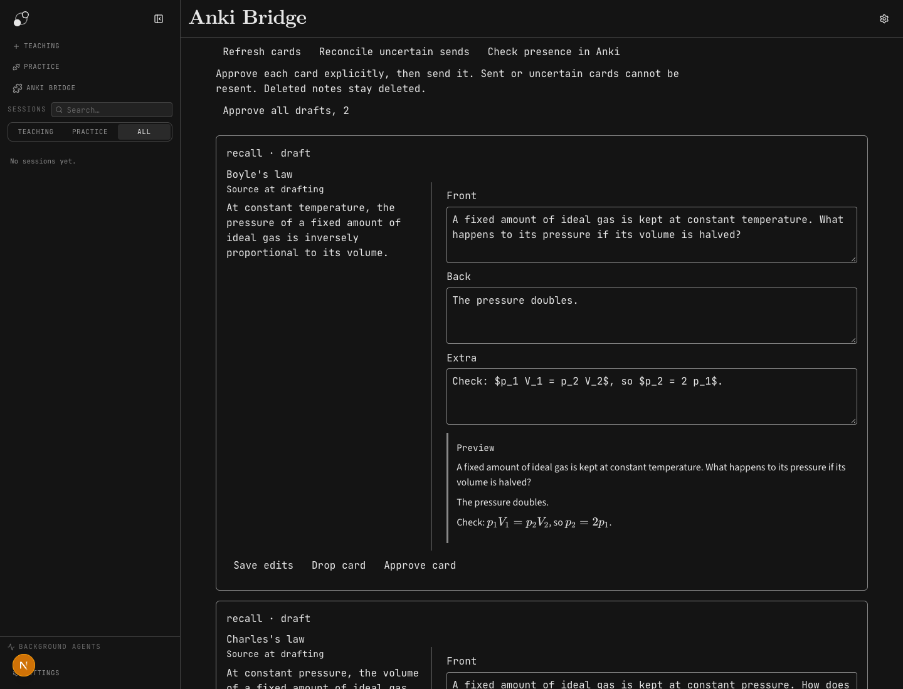

# Anki Bridge

An unofficial LearnHarness community plugin in development. The goal is to draft cards from your knowledge graph, let you edit and approve them, and send them to Anki through AnkiConnect. Delivery is one-way; Anki keeps responsibility for reviews and scheduling. This project is not affiliated with Anki or LearnHarness.

**Version 0.6.0 is a personal-use candidate.** It packages the existing workflow as an install zip and documents how to install and upgrade it. There is no public release yet. See the [install guide](docs/install.md) for requirements, setup and troubleshooting.


Graph drafting, review and delivery work with session flags and session-based selection. Version 0.5.0 adds coverage labels, reversible dismissals and a shared no-cards filter to the manual and session pickers.

## What's done

| Version | Status | Work completed |
| --- | --- | --- |
| 0.1.0 | Merged | Shared writer input builder, graph context, batching, prompts, result schema and validation. Sonnet bench with real QM nodes and labelled synthetic fixtures. Local browser scoring, JSON results and per-run reports. |
| 0.1.1 | Merged in [PR #1](https://github.com/Singh-Mehtab/learnharness-anki-bridge/pull/1) | Multiline code support, stronger accuracy and answer-leak guidance, soft word targets, a hard generation-call budget, and separate automated/human scoring. 22 tests, typecheck and browser checks passed. Sol approved the code. |
| 0.2.0 | Merged in [PR #2](https://github.com/Singh-Mehtab/learnharness-anki-bridge/pull/2) | Connection/profile pairing, owned Basic note type, approval, durable delivery, interrupted-send recovery, presence checks and Show in Anki. Final merged head passed 77 tests, build and typecheck. Real AnkiConnect and scratch LearnHarness checks predate the final renderer fixes and main merge. |
| 0.3.0 | Merged in [PR #5](https://github.com/Singh-Mehtab/learnharness-anki-bridge/pull/5) (`e88f89d`) | Native graph and model pickers, configurable card kinds and cap, confirmed preflight, worker generation, source-aware editable review with previews, bulk approval/send, dropping cards and generation recovery. 100 tests, typecheck and build pass. A scratch LearnHarness run with a local stub model passed seven end-to-end checks and a restart-during-generation check. Not yet tested with a real model in the app, or by sending generated cards to Anki. See [verification and limits](docs/0.3.0-verification.md). |
| 0.4.0 | Merged in [PR #4](https://github.com/Singh-Mehtab/learnharness-anki-bridge/pull/4) | Flag for Anki and Make cards in the teaching top bar, flag notes passed to the writer, waiting-for-extraction status, and session node selection that feeds the draft panel. 137 tests, typecheck and build pass. Both Sol reviewers approved after three rounds each. Earlier scratch LearnHarness checks passed 17 session checks and 9 integrated drafting checks with a local stub. No real model or Anki calls were made. See [verification and limits](docs/0.4.0-verification.md). |
| 0.5.0 | Merged in [PR #7](https://github.com/Singh-Mehtab/learnharness-anki-bridge/pull/7) | Shared destination-aware coverage, changed/missing-source warnings, dismiss/restore, coverage-aware node lists and no-cards backfill. State schema 4 preserves older cards, flags and generation recovery data. See [verification and limits](docs/0.5.0-verification.md). |
| 0.6.0 | Personal-use candidate | Install zip and upgrade instructions. No new workflow features. See [verification and limits](docs/0.6.0-verification.md). |

### Card writer

- Core kinds: recall, why, compose and discriminate. Why/compose need supporting chains; discriminate needs a relevant neighbour.
- A cap of one to four cards per node, two by default. The cap is a maximum, not a quota. The writer prefers one useful card over a near-duplicate pair.
- Soft targets of 30 front words and 15 back words. Correctness and necessary assumptions take priority.
- Maths, inline code and multiline fenced code. Images and Mermaid are unsupported in cards.
- Deterministic checks for structure, allowed kinds, duplicates and surface answer leaks. These checks cannot guarantee factual accuracy or detect every semantic leak.

Mini-problem and spot-the-mistake kinds remain experimental and off by default.

### Quality evidence and limits

The original core bench failed the zero-answer-leak criterion. The 0.1.1 follow-up produced 32 cards from previously unused QM target nodes in the same lecture. Sol provisionally kept 24 of 32 as-is or with small edits, with no flagged leaks or factual errors among the kept cards. Five rejected cards had factual-error flags.

That is a partial result, **not a full benchmark pass**. Claude's quota stopped both synthetic-subject batches. The fixtures are hand-written and cleaner than real extraction output; the QM sample is not from an independent lecture. Human spot-checks and model scores remain separate.

Additional card-quality validation is deferred until before public release. No automatic rerun is scheduled. See the [bench guide](bench/README.md) and [0.1.1 closeout](bench/0.1.1-closeout.md) for methods and limitations. Private graph data, generated cards and per-card scores are not committed.

### Session flags (0.4.0)

In a teaching session, **Flag for Anki** in the top bar marks the teacher's latest reply for cards. A click opens a dialog for an optional note such as "I got the sign wrong"; the card writer receives the note with that idea. The shortcut, `Cmd/Ctrl+Shift+A` by default, flags straight away and offers the note in a short confirmation. The button is disabled while a reply is still streaming.

A flag covers every idea LearnHarness extracted from that reply, which is usually about two. You can't flag a single sentence.

LearnHarness extracts ideas after a reply settles and doesn't announce when it finishes. Until it does, a flag shows "waiting for extraction". The panel re-checks when extraction activity changes, and Refresh checks on demand. A flag whose reply produced no new ideas says so. Flags are kept until you remove them, including flags on deleted sessions.

**Make cards** opens Anki Bridge on the session. Flagged ideas are ticked, even if they already have cards; carded ideas are greyed. Current dismissals and ideas blocked by unresolved delivery or generation stay unticked. "Select all uncarded" ticks every idea without cards and estimates the card count using your saved cap. **Draft cards for selected** replaces the draft panel's selection and clears any old estimate. It never starts generation. You still choose a model, estimate and confirm.

Flag notes go into the writer prompt. Changing a note makes an open estimate stale, so the backend requires a fresh estimate before generating. The session's card counts update when drafting finishes.


Screenshot from the integrated scratch-host run with a synthetic session. [Session selection and generation estimate](docs/images/0.4.0-session-drafting.png) shows the same session feeding the draft panel. See [0.4.0 verification](docs/0.4.0-verification.md) and the [session flow contract](docs/session-contract.md).

### Coverage and backfill in 0.5.0

Both pickers show whether an idea has no cards, drafts waiting, sent cards or a current dismissal. Source changes and missing sources have separate warnings. Mixed sent and waiting counts remain visible. Coverage counts cards sent to the paired URL and profile across all decks; cards sent elsewhere carry a warning. These are saved records, not a live Anki presence check. A note deleted in Anki stays deleted and does not automatically return to backfill.

Use "No cards" and search to narrow the list, then "Select all uncarded" to select visible eligible ideas. The displayed card count is a maximum. Dropped-only ideas are eligible again. Changed sources require an explicit choice from "All nodes"; missing sources appear as nonselectable history. Changing the filter or search removes hidden selections and clears the estimate. Opening the graph-wide picker selects nothing by default. Both views enforce a 1,000-node limit without truncating a bulk or default selection. Narrow the search or scope if too many ideas qualify.

Bulk selection retains backfill intent through estimates, confirmation and retries, including after restart. If an idea gains coverage before an estimate or retry, the backend rejects that backfill target. Choose it individually to request another angle; the bridge never silently changes backfill into an explicit request.

"Don't card this" dismisses the current statement across sessions and profiles. It never drops drafts or changes Anki. Review or drop waiting drafts and settle generation or delivery before dismissing an idea. "Restore" makes it selectable again. A changed statement expires its old dismissal and shows a source warning. A model skip does not create a dismissal. The native model picker remains; coverage uses plugin-owned rows because the host knowledge picker cannot accept labels or filters.

Coverage loads without a selected model or live Anki connection. If a graph read fails, the last rows remain visible but stale, and selection is disabled until "Refresh graph" succeeds. Node IDs determine coverage. Alias text cannot transfer old coverage to a recreated idea. "Source missing" means absent from the returned graph snapshot, not confirmed deletion. The host can silently omit unreadable or invalid ledger data, so keep that uncertainty in mind.

## Development preview



This is a real screenshot from the 0.3.0 scratch run, not a mockup. The graph has two synthetic nodes, and the drafts come from a local stub model, so the screenshot shows the workflow, not real card quality. The [estimate screen](docs/images/0.3.0-preflight.png) comes from the same run.

The 0.2.0 tests used LearnHarness 0.6.1, Anki 26.08.1 and AnkiConnect builds 26.10.11.0 and 26.11.15.0. They covered note type creation and repair, duplicate rejection, profile mismatches, Show in Anki, and recovery after killing the bridge immediately after a real `addNote`. See [0.2.0 verification](docs/0.2.0-verification.md) and [0.3.0 verification](docs/0.3.0-verification.md).

## Development setup

Use Node.js 23.6 or newer, npm, and Info-ZIP-compatible `zip` and `unzip` for the packaging tests. The tests need `unzip -Z1`, which BusyBox `unzip` does not support.

```sh
npm ci
npm test
npm run typecheck
npm run build
```

Inspect batch packing without making model calls:

```sh
npm run bench:run -- --dry-run
```

Dry runs still need the selected fixture sets. The default includes a private `qm` set; [prepare your own fixtures or select synthetic sets](bench/README.md). The following works with the committed fixtures only:

```sh
npm run bench:run -- --dry-run --sets humanities,programming
```

The bench uses the authenticated Claude Code CLI. In-app drafting uses your explicitly selected LearnHarness model and its provider account, including subscription quota on Claude Code routes. The automated tests and dry runs make no model calls.

### Try the development workflow

For development tests, use a throwaway Anki profile and a LearnHarness checkout with scratch `LH_DATA_DIR` and `LH_AUTH_FILE` paths. Generation consumes your selected provider's quota only after you confirm the preflight.

1. Install [AnkiConnect](https://git.sr.ht/~foosoft/anki-connect) and open the throwaway Anki profile. The tested AnkiConnect builds require Anki 26.08 or later. The bridge also requires `getActiveProfile`; older builds without it are refused.
2. Install the built plugin in the scratch app's plugins directory, shown under Settings → Community plugins:

   ```sh
   npm run install:local -- "/absolute/path/to/scratch/plugins"
   ```

   The installer replaces `anki-bridge/dist/` and preserves its sibling `data/`. Discovery leaves the plugin disabled. Enable it in settings; restart LearnHarness after changing already-loaded plugin code.
3. Open Anki Bridge from the sidebar. Save the AnkiConnect URL and optional API key, then test the connection. The default is `http://127.0.0.1:8765`; check your local port first because another service may use it. Use a separate port for isolated tests.
4. Choose graph nodes from All nodes or No cards, optionally narrow them with search, and select a configured model. Set the maximum cards per node and enabled kinds. Click Estimate generation and check the node count, maximum cards, number of model calls and token estimate. Estimating calls no model. A dollar estimate appears only when the model catalog supplies pricing. Click Confirm and generate to start. You can close the view while it runs. Cancelling keeps drafts from completed tasks.
5. Review each card beside the source statement captured at drafting. Check correctness and assumptions, edit as needed and save. The live preview supports maths and code. Length warnings are advisory. Drop unwanted cards, then approve cards individually or confirm bulk approval. Editing clears approval. No generation result is approved automatically.
6. Test and pair the displayed throwaway Anki profile. Choose an existing or new deck and send approved cards. Check presence or use Show in Anki. URL or profile mismatches block sends and reconciliation; do not switch profiles during a send, since AnkiConnect cannot make a profile check and write atomic.

Use Refresh generation to inspect running or interrupted tasks. Completed worker results are applied at most once. Retry offers a new preflight for unsuccessful tasks; it does not regenerate successful tasks. Source changes and missing nodes are shown without changing Anki notes. Writing a card by hand is still available in a collapsed section.

The bridge never updates or deletes existing Anki notes or their review history. Field repair and styling replacement are separate actions; styling replacement can overwrite template edits after confirmation. Close affected Anki editors before either operation.

The optional API key is stored in plain text in the plugin's `data/` directory. Keep it private, use loopback and a trusted local AnkiConnect service, and never distribute `data/`. A remote HTTP endpoint can expose both the key and card content. The saved key is not displayed; a blank key input keeps it, and the clear checkbox removes it.

The opt-in [live integration test](docs/0.2.0-verification.md) requires an isolated profile named `Anki Bridge Test`, leaves notes in that collection, and refuses ports 8765 and 8766. It does not start or stop Anki. The core Flashcards plugin is independent and can remain enabled.

## Before public release

The full card-quality benchmark is still open. A personal trial can find setup and workflow problems, but it does not close that quality check. Public availability and community announcements are separate decisions.

## Keeping this page current

Every version change, including patches, must update this README in the same PR. Keep the current version, completed work, test evidence, limitations and screenshots accurate. Mark unmerged or planned work explicitly. Repository instructions enforce this rule for coding agents.

## License and acknowledgements

[AGPL-3.0-only](LICENSE).

The writer adapts card-design guidance from [LearnHarness core Flashcards](https://github.com/amosblomqvist/learnharness/tree/v0.6.1/plugins/flashcards) and [Twig](https://github.com/amoghu1s1/twig), under AGPL-3.0. Anki Bridge uses a different approval-first, one-way delivery design. [AnkiConnect](https://git.sr.ht/~foosoft/anki-connect) provides the local Anki API.
