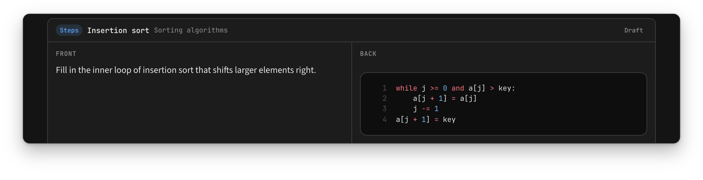
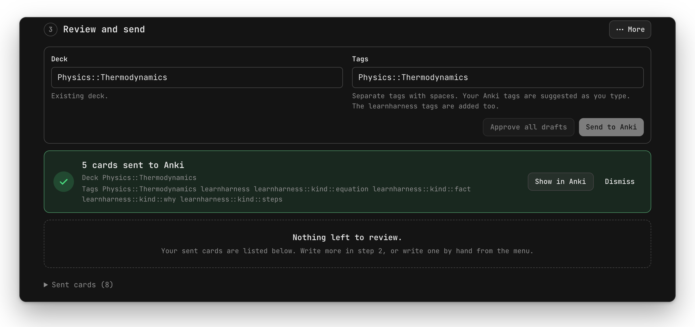
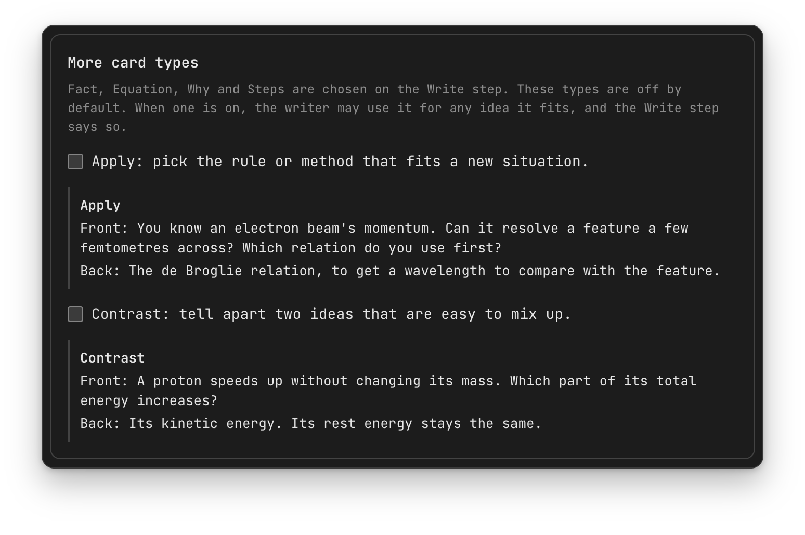

<h1 align="center">
  <picture>
    <source media="(prefers-color-scheme: dark)" srcset="docs/images/readme/banner-dark.png">
    <source media="(prefers-color-scheme: light)" srcset="docs/images/readme/banner-light.png">
    
  </picture>
</h1>

<strong>Turn what you learn in LearnHarness into Anki cards you have checked.</strong>

  <a href="#install">Install</a> ·
  <a href="#how-it-works">How it works</a> ·
  <a href="#card-types">Card types</a> ·
  <a href="#topics-to-revisit">Topics to revisit</a> ·
  <a href="#what-goes-where">What goes where</a> ·
  <a href="CHANGELOG.md">Changelog</a>

Version 0.8.0 · No public release yet · Build from source

Anki Bridge is a community plugin for [LearnHarness](https://github.com/amosblomqvist/learnharness). It reads the ideas in your knowledge graph, has your model draft flashcards from them, and adds the ones you approve to [Anki](https://apps.ankiweb.net/). You edit and approve every draft, and Anki schedules the reviews. Only cards you approve are added, either when you press Send or when you import a package you downloaded.

<picture>
  <source media="(prefers-color-scheme: dark)" srcset="docs/images/readme/how-it-works-dark.png">
  <source media="(prefers-color-scheme: light)" srcset="docs/images/readme/how-it-works-light.png">
  
</picture>

## Why it works this way

**Cards start from your graph.** Each LearnHarness idea is a single claim, linked to the ideas that support it and the teaching reply it came from. The model gets the idea, nearby linked ideas and an excerpt of that reply, so a Why card can ask for the reasoning you were taught.

**You review every card.** Model-written cards are often close but not quite right, so every draft waits for you to check and edit it. Studies find that cards learners make themselves work better than premade decks ([Pan et al., 2022](https://doi.org/10.1037/mac0000083)), and checking and editing each draft keeps part of that work with you. The review screen is built for editing, with the source idea one click away and a live preview below each field.

**It only adds notes.** A send creates notes in Anki Bridge's own note type. It never edits or deletes an existing note and never changes scheduling or review history. If you change a card in Anki, your change stays. Importing a downloaded package is different, because Anki decides what an import does (see [Download a package instead](#download-a-package-instead)).

**Maths and code keep their formatting.** Cards use MathJax for equations and keep fenced code blocks with their indentation, both in the preview and in Anki.

## How it works

### Flag replies while you learn (optional)

When a teaching reply covers something you want to keep, press **Flag for Anki** in the session's top bar. It flags the latest finished reply and lets you leave a note for the card writer, such as the mistake you made. Cmd+Shift+A (Ctrl+Shift+A on Windows and Linux) flags it at once, and the confirmation offers to add a note. The flag covers every idea LearnHarness extracts from that reply, and flagged ideas can get up to 12 cards. **Make cards** in the same bar opens Anki Bridge with that session's flagged ideas ticked.

You don't have to flag anything. You can make cards for any idea in your graph.

### 1. Choose ideas

Open **Anki Bridge** from the LearnHarness sidebar. The page has three steps, top to bottom.

Under **Ideas from**, pick a session or your whole graph, and tick the ideas you want cards for. Each idea shows where it stands: flagged, no cards yet, drafts to review, already in Anki, or changed since you made its cards. **Select ideas without cards** ticks every idea in the current view that has none. If that would be more than 1,000 ideas, it asks you to narrow the view first. To leave an idea out of future card writing, choose **Don't make cards for this idea** from its menu.

### 2. Write cards

Tick the card types you want (Fact, Equation, Why and Steps) and set the most cards per idea. **See examples** shows a sample card for each type. Leave the model picker blank to use your LearnHarness cheap model, or pick another model.

Press **Write cards**. A dialog shows the number of model calls, the most cards it can write, a cost estimate for the first attempt when the model has pricing, and a summary of what will be sent to the model. It also lists any ideas it will skip, such as ones too large for the model's limits. Nothing is sent until you press **Start writing**.

Writing happens in the background, so you can keep learning. If a run is cancelled or a batch fails, cards from finished batches are kept. **Retry the rest** (or **Try again**, if no batch finished) makes a new estimate for the remaining ideas.

### 3. Review and send

Every draft shows its front, back and optional extra field, with maths and code rendered. Open **Idea when this card was written** to compare a card with its source. Edit, drop or approve cards one at a time, or approve all drafts once you have read them. Long cards get a warning but can still be approved. You can also write a card by hand from the **More** menu.

Pick a deck (or type a new one), check the tags and press **Send to Anki**. The deck field suggests your Anki decks and says when a name is new. The tags field suggests tags from your Anki collection and starts from a template you set once in settings. A green panel confirms how many cards were sent, to which deck, with which tags, and **Show in Anki** opens them in Anki's browser.

#### Download a package instead

**Download .apkg**, next to Send to Anki, saves the approved cards as a package file. It needs a deck name but no AnkiConnect, and Anki can be closed. Open the file with Anki, or use **File → Import**, to add the cards. The package has the same fields, formatting, tags and note type as a send.

A download is not a send. The cards stay approved, they don't count as in Anki, and you can still send them. Anki decides how to match an imported package with your collection. Depending on Anki's import settings, importing can add duplicates of cards you sent directly, or update notes from an earlier package of the same cards, including edits you made to them in Anki. Anki Bridge can't check what an import will do.

## Card types

<picture>
  <source media="(prefers-color-scheme: dark)" srcset="docs/images/readme/card-types-dark.png">
  <source media="(prefers-color-scheme: light)" srcset="docs/images/readme/card-types-light.png">
  
</picture>

| Type | What it asks you to do | Where to turn it on |
| --- | --- | --- |
| Fact | Remember a definition, unit, prefix or other fact | On by default |
| Equation | Recall a formula or relation | On by default |
| Why | Explain why a result holds | Write step |
| Steps | Recall the next step in a method you carry out | Write step |
| Apply | Pick the rule or method that fits a new situation | Settings, under **More card types** |
| Contrast | Tell apart two ideas that are easy to mix up | Settings, under **More card types** |

The model writes only types that fit an idea. Why needs supporting ideas in the graph, and Contrast needs a similar neighbouring idea. An idea can also get no card at all if the model can't write a useful one it can check, and it says why. The numerical values of physical constants are not carded unless you flag the idea that states one or ask for it in a flag note. A conversion constant you use in calculations, such as $\hbar c$, can still get a card.

Earlier versions also drafted Compose cards. Cards you already have of that type stay readable.

  

## Topics to revisit

Open **Topics to revisit** from the sidebar, or from **More** in step 3, and press **Check Anki reviews**. Anki Bridge reads review history only when you press it. It reads review results for the notes it sent to your paired profile and lists a topic when one of its cards has 3 or more lapses, 2 or more Again presses in the last 30 days (on reviews or relearning steps), or Anki's leech tag.

Each topic shows its cards with their lapses, reviews, recent Again dates and deck, with buttons to open the session the idea came from and to show a card in Anki. The list suggests what to look at again. It doesn't prove you don't know something, because a card you keep missing may be badly worded. Results stay in memory until you press **Clear**, change the Anki address, key or profile, or close LearnHarness. They are not saved, added to your graph or sent to a model.

## Install

> [!NOTE]
> Anki Bridge has no public release yet. Version 0.8.1 is the current build for personal use. Use the `anki-bridge-v0.8.1.zip` install archive if you have it, or build it from source using the [install guide](docs/install.md#build-the-zip-from-source). GitHub's automatically generated source zip is not the install archive.

### What you need

- [LearnHarness](https://github.com/amosblomqvist/learnharness) with community plugins (plugin API v1). Tested on 0.6.1 on macOS. The plugin allows later versions but has not been tested on them.
- A model set up in LearnHarness, for writing cards. Choosing ideas, estimating cost and sending make no model calls. Writing cards uses your provider's quota.
- For sending and Topics to revisit, Anki Desktop 26.08 or later with the [AnkiConnect](https://git.sr.ht/~foosoft/anki-connect) add-on, running while you use them. Tested with AnkiConnect 26.10.11.0 and 26.11.15.0. Builds without `getActiveProfile` are refused, because the plugin uses it to check it is writing to the right profile. **Download .apkg** works without AnkiConnect.
- To build the zip yourself, Node.js 23.6 or later, npm and the `zip` command. You don't need these to install a prebuilt zip.

### Steps

1. In LearnHarness, open **Settings → Community plugins** and copy the plugins folder path. Quit LearnHarness completely. On Mac, use **Quit** or ⌘Q; closing the window is not enough.
2. If the plugins folder already contains `anki-bridge`, stop and follow the upgrade steps below. Otherwise, extract the install zip outside the plugins folder.
3. Open any folder created by your extractor. Move the inner `anki-bridge` folder into the plugins folder. Check that the manifest is at `<plugins folder>/anki-bridge/dist/manifest.json`, with no version-named folder above `anki-bridge`.
4. Start LearnHarness, enable **Anki Bridge** under Community plugins, and open it from the sidebar.

To upgrade, quit LearnHarness, privately back up `anki-bridge/data/`, then replace only `anki-bridge/dist/`. Do not merge folders or replace the whole `anki-bridge` folder. The `data/` folder holds your drafts, flags, send history and any saved API key. The [install guide](docs/install.md) has the full upgrade, rollback and troubleshooting steps.

> [!WARNING]
> Community plugins run local code with the same access as LearnHarness. Only install a build you trust.

### Connect to Anki

Skip this if you only want to download packages. Otherwise, open Anki on the profile you want cards in. A throwaway profile is a good place to start.

1. In **Settings → Anki Bridge**, check the AnkiConnect address (usually `http://127.0.0.1:8765`). Add an API key if you set one in AnkiConnect.
2. If you changed the address or key, press **Save**. Then press **Test connection**.
3. Press **Use the open profile**, check the profile name, and confirm with **Use this profile**.

From then on, the plugin checks the profile before every send and review check, and stops if a different one is open.

  

## What goes where

| | What | When |
| --- | --- | --- |
| To your model | The chosen ideas, nearby linked ideas, an excerpt of the reply each idea came from when there is one, your flag notes, and up to six recent cards Anki Bridge made for each idea | When you press **Start writing** |
| Written to Anki | Approved cards as new notes in the note type `LearnHarness Basic` (fields Front, Back, Extra, Source, LH_ID and LH_Node). A send also creates the deck and the note type if they are missing. | When you press **Send to Anki** |
| Changed in Anki on request | The `LearnHarness Basic` note type's missing fields, styling and templates | Only when you confirm a repair or reset in settings |
| Read from Anki | The open profile, deck names and tags, the note type, and the notes Anki Bridge sent, to check they still exist | Profile, decks and tags when you open the page. The rest when you send, when you run a check from the **More** menu, and when LearnHarness starts with an unconfirmed send. |
| Read for Topics to revisit | Lapses, reviews, review logs, fields, tags, deck and suspended status of the notes Anki Bridge sent to the paired profile | Only when you press **Check Anki reviews** |
| Saved to a file | Approved cards, their source names and their Anki Bridge and LearnHarness IDs, in an `.apkg` package | When you press **Download .apkg**. Neither Anki nor your model is contacted. |
| Never changed | Existing note content, scheduling and review history | Never |

If you set an API key, it goes with every AnkiConnect request. By default each note also gets the tags `learnharness` and `learnharness::kind::<type>` (Contrast cards use `discriminate`), so you can find plugin cards in Anki. You can turn these tags off in settings. Drafts, flags and send records stay in the plugin's own data folder inside LearnHarness. Your LearnHarness graph and sessions are read, never changed.

## Limitations

- Cards are Basic front-and-back notes. Cloze, reversed and type-in cards are not supported.
- Images and Mermaid diagrams cannot go in cards.
- Card quality depends on your model, so check every draft. The writer was tuned on one lecture and has not been benchmarked on new subjects.
- The 0.8.0 interface was checked with synthetic data in a scratch LearnHarness. Native Windows testing of 0.8.1 remains open, as does an end-to-end test of the 0.8.0 writer with a live model and a real Anki profile.
- Downloaded packages have been checked with SQLite and zip readers but not yet imported into Anki.
- Sending and Topics to revisit need Anki Desktop open with AnkiConnect. Don't switch Anki profiles during a send, because AnkiConnect cannot check the profile and write in a single step.
- An optional AnkiConnect API key is stored in plain text in the plugin's data folder.

## Roadmap

These are plans, not commitments.

- Use 0.8.0 day to day and test card quality on material the writer was not tuned on.
- A first public release.
- An idea for later: practice sessions aimed at topics to revisit.

## Questions

**Does this replace the built-in Flashcards plugin?** No. Flashcards schedules reviews inside LearnHarness. Anki Bridge hands cards to Anki and lets Anki schedule them. The two share no data and can both be enabled.

**What happens if I edit a card in Anki?** Your edit stays. The plugin never updates a note after sending it. (Re-importing a downloaded package can, depending on Anki's import settings.) If you write more cards for an idea, the model sees up to six recent cards Anki Bridge made for it, as the plugin stored them, and tries new angles. It does not see edits made in Anki.

**What if a send is interrupted?** The plugin records each card before adding its note. When LearnHarness starts again, the plugin looks for those cards in Anki itself and marks each one sent or failed. If Anki wasn't open on the paired profile, reconnect to the same address and profile, then use **Check unconfirmed sends** in the **More** menu. Use **Retry send** only on cards marked failed. If the check itself fails, leave those cards alone and try the check again later.

**Is it affiliated with Anki or LearnHarness?** No. It is an unofficial community plugin.

## Development

See [docs/development.md](docs/development.md) for setup, tests and the card-quality bench, and [CHANGELOG.md](CHANGELOG.md) for version history. The README images are made from synthetic data. Their sources are in [docs/images/readme/src](docs/images/readme/src).

## Credits and license

The card writer adapts card-kind and prompt rules from [Twig](https://github.com/amoghu1s1/twig), from LearnHarness's core Flashcards plugin, and from the LearnHarness recall-cards proposal ([PR #447](https://github.com/amosblomqvist/learnharness/pull/447)), all AGPL-3.0. The `.apkg` layout follows [genanki](https://github.com/kerrickstaley/genanki) (MIT). The development SDK types and local install script come from LearnHarness. See [THIRD_PARTY_NOTICES.md](THIRD_PARTY_NOTICES.md).

Anki Bridge is licensed under [AGPL-3.0](LICENSE).
