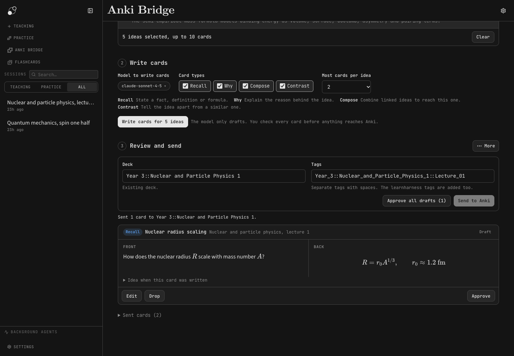
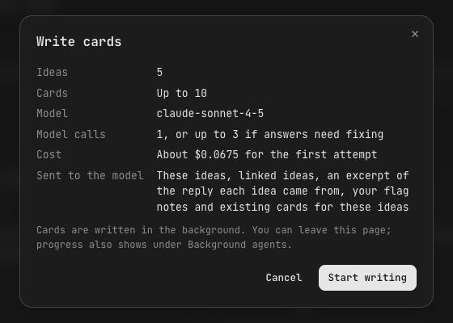
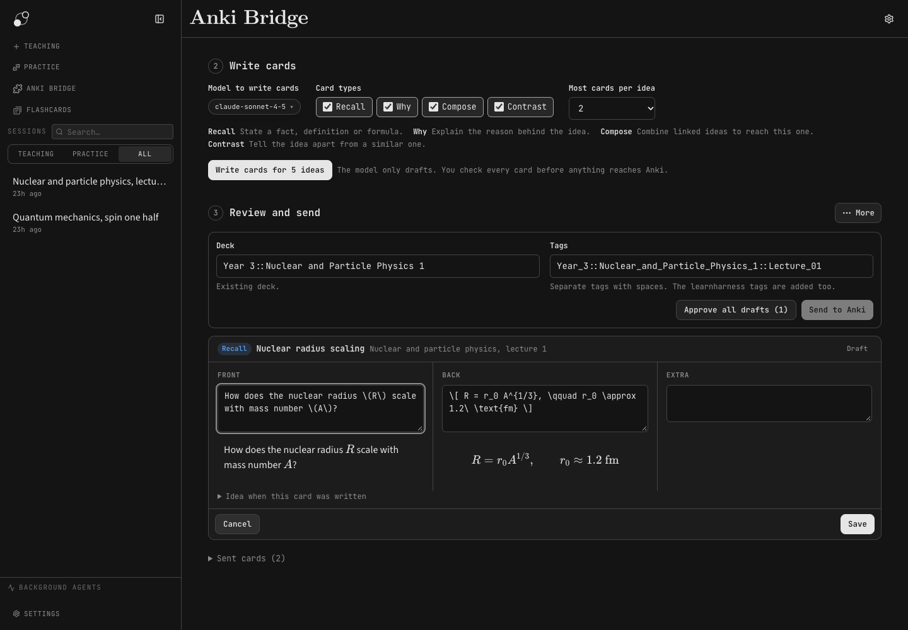
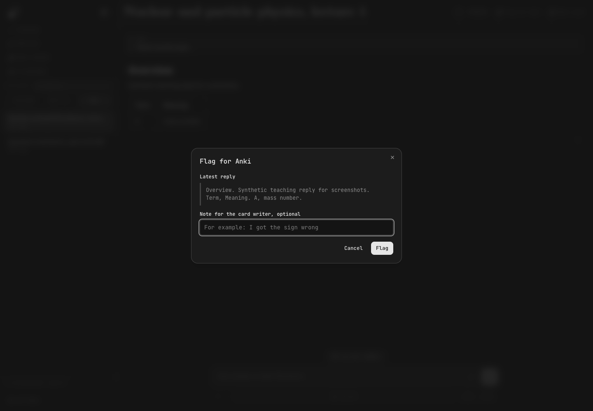
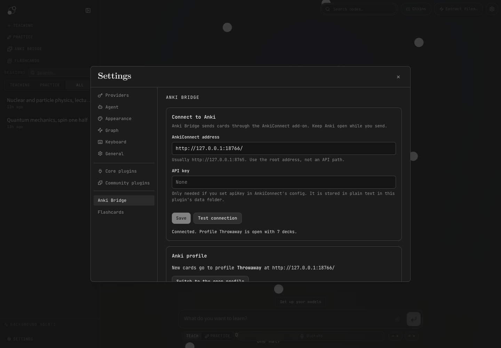

# Anki Bridge

Anki Bridge turns what you learn in [LearnHarness](https://github.com/amosblomqvist/learnharness) into Anki cards. A model drafts cards from the ideas in your knowledge graph. You check and edit each one, and only the cards you approve go to Anki through AnkiConnect.

> Version 0.7.0 is a personal-use candidate. There is no public release yet. Anki Bridge is an unofficial community plugin and is not affiliated with Anki or LearnHarness.



## What it does

- Drafts cards from your own graph. The writer works from the ideas LearnHarness extracted while teaching you, with linked ideas as context.
- Sends nothing without your approval. Every card starts as a draft, and editing an approved card makes it a draft again.
- Lets you flag the replies you struggled with. One click in a lesson marks the teacher's reply, and you can leave a note such as "I got the sign wrong" for the writer.
- Writes maths for Anki's MathJax, with equations on their own lines.
- Tags cards to match your collection. A template such as `{deck}::Lecture_01` tags each card by deck and lecture, and you can change the tags before each send.
- Shows what you have already covered. Each idea says whether it has cards in Anki, cards waiting for review, or none, so you can fill the gaps.
- Only adds notes. It never edits or deletes existing Anki notes, and Anki keeps your reviews and scheduling.

## How it works


The Anki Bridge page has three numbered steps.

### 1. Choose ideas

Under "Ideas from", pick one teaching session or your whole graph. In a session, the ideas from flagged replies start ticked. Each idea shows whether it already has cards, and "Select ideas without cards" ticks the gaps.


### 2. Write cards

Choose a model, the card types you want and the most cards per idea. There are four types. Recall asks for a fact, definition or formula. Why asks for the reason behind an idea. Compose combines linked ideas to reach this one. Contrast tells the idea apart from a similar one.

Write cards shows the size and estimated cost of the run before anything starts. The model drafts in the background, so you can leave the page. Progress also shows under Background agents.



### 3. Review and send

Each card shows Front, Back and Extra side by side with the maths rendered. Edit opens the TeX source with a live preview underneath. Approve the cards you're happy with, check the deck and tags, then send. The deck field suggests your Anki decks and tells you when a name is new.



## Install

You need LearnHarness 0.6.1 or later, Anki Desktop 26.08 or later with [AnkiConnect](https://git.sr.ht/~foosoft/anki-connect), and a model set up in LearnHarness. Writing cards uses that model provider's quota. Estimates make no model calls.

There is no download yet. Build the install zip from a checkout of this repository with Node.js 23.6 or later:

```sh
npm ci
npm run package:plugin
```

This writes `anki-bridge-v0.7.0.zip` at the repository root. Then:

1. In LearnHarness, open Settings → Community plugins and copy the plugins folder path. Quit LearnHarness.
2. Unzip the archive and move the `anki-bridge` folder into the plugins folder.
3. Restart LearnHarness and enable Anki Bridge under Community plugins.
4. Open Anki with AnkiConnect running. In LearnHarness, open Settings → Anki Bridge. Save the AnkiConnect address, press Test connection, then choose Use the open profile.
5. Open Anki Bridge from the sidebar.

The [install guide](docs/install.md) covers upgrading without losing drafts, rolling back and troubleshooting.

## Flag replies during a lesson

In a teaching session, Flag for Anki in the top bar marks the teacher's latest reply. You can add a note for the writer. `Cmd/Ctrl+Shift+A` flags straight away and offers the note in a short confirmation. Make cards opens Anki Bridge with that session's flagged ideas ticked.

A flag covers every idea LearnHarness extracts from that reply. Extraction runs after the reply finishes, so a new flag can show as waiting for a short time.



## Tags

Set "Tags for new cards" in the Anki Bridge settings. Separate tags with spaces. `{deck}` becomes the deck name with spaces replaced by underscores. With the template `{deck}::Lecture_01` and the deck `Year 3::Nuclear Physics`, cards get the tag `Year_3::Nuclear_Physics::Lecture_01`. Anki treats tags that differ only in case as the same tag, so this matches an existing `YEAR_3::Nuclear_Physics` hierarchy.

The send step shows the tags before each send, and you can change them there. Cards also get `learnharness` and a card-type tag such as `learnharness::kind::why`. You can turn these off in settings.

## Settings

The Anki Bridge settings hold the AnkiConnect address and optional key, the Anki profile cards go to, the tag template, and repairs for the bridge's note type. Test connection says plainly when Anki is closed or AnkiConnect isn't reachable.



## The card writer

- One to four cards per idea, two by default. This is a limit, not a target. The writer prefers one useful card to a near-duplicate pair.
- Fronts aim for about 30 words and backs for about 15. Correctness and any assumptions the answer needs come first.
- Every variable, symbol and equation is written as maths. Fenced code keeps its indentation. Images and Mermaid diagrams aren't supported in cards.
- Why and Compose cards need a supporting chain of ideas in the graph, and Contrast cards need a similar neighbouring idea. Otherwise the writer skips them.
- If the writer can't check a card's claims, it returns no card for that idea and says why.
- Automatic checks catch broken structure, duplicate cards and answers leaked into the question. They can't prove a card is correct, so read each one before approving it.

## Privacy and safety

- Writing cards sends the chosen ideas to the model provider you picked, along with their linked ideas, an excerpt of the session reply each idea came from (flagged or not), your flag notes and any existing cards for those ideas. The Write cards dialog lists this before anything is sent.
- The optional AnkiConnect key is stored in plain text in the plugin's `data/` folder. Never share that folder. Use AnkiConnect on your own machine.
- Community plugins run local code with LearnHarness's permissions. Install builds you trust.
- Adding missing fields and resetting styling and templates only change the bridge's own note type, and both ask you to confirm first.

## Limitations

- Card quality hasn't been benchmarked yet. An early trial on quantum mechanics lecture ideas kept 24 of 32 cards as written or with small edits. See [development notes](docs/development.md#card-quality-evidence).
- The 0.7.0 interface was checked in a scratch LearnHarness with made-up data and a stand-in for AnkiConnect. Delivery to real Anki was tested in 0.2.0. See [0.7.0 verification](docs/0.7.0-verification.md).
- Tested only on macOS with LearnHarness 0.6.1.

## Roadmap

- Done: drafting from the graph, session flags, coverage labels, delivery to Anki and the 0.7.0 redesign. See the [changelog](CHANGELOG.md).
- Next: a card-quality benchmark on real lecture graphs, then a longer personal trial.
- After that: a public release, then a listing in the LearnHarness community plugin list.
- Ideas, not scheduled: sending cards you keep failing in Anki back to LearnHarness as weak spots, and practice sessions aimed at those weak spots.

## Development

```sh
npm ci
npm test
npm run typecheck
npm run build
```

[Development notes](docs/development.md) cover the scratch test setup, the card-quality bench and earlier verification. The [generation](docs/generation-contract.md) and [session](docs/session-contract.md) contracts describe how the plugin works inside.

## License and acknowledgements

[AGPL-3.0-only](LICENSE).

The writer adapts card-design guidance from [LearnHarness core Flashcards](https://github.com/amosblomqvist/learnharness/tree/v0.6.1/plugins/flashcards) and [Twig](https://github.com/amoghu1s1/twig), under AGPL-3.0. Anki Bridge uses a different approval-first, one-way delivery design. [AnkiConnect](https://git.sr.ht/~foosoft/anki-connect) provides the local Anki API.
