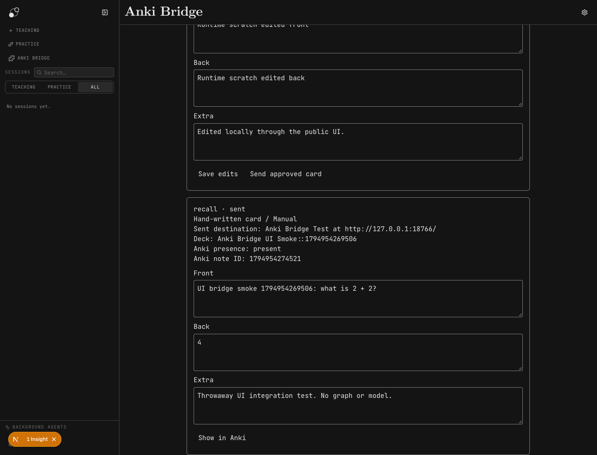

# 0.2.0 verification

Observed on 2026-11-17. This is implementation/test evidence, not user acceptance or a completed PR review.

## Automated checks

- `npm run typecheck` passes.
- `npm test` passes 66 tests, with no skips.
- `npm run build` produces the API-v1 distribution for LearnHarness 0.6.1.

Tests cover connection/envelope/key failures, URL validation, null profiles, safe HTML/math/code rendering, owned note-type checks and explicit repair, durable approvals, duplicate/per-card failures, destination guards, presence/deletion, single-send fencing, restart recovery and disable during a request. An actual child process is killed after `addNote` and before its state write. UI, distribution and installer tests use synthetic contexts and temporary directories.

## Real Anki compatibility

Both supported runs used the official Anki 26.08.1 Apple Silicon binary, separate scratch base directories and a profile named `Anki Bridge Test`. No requests went to a personal collection or ports 8765/8766.

| AnkiConnect build | Upstream revision | Result |
| --- | --- | --- |
| 26.10.11.0 | `f69c9e46b9cfe77191b9685156d9ff86e71a5a88` | Nine integration checks pass |
| 26.11.15.0 | `ee75fcf14a3ba310f02622e120359627b0e2c8e5` | Nine integration checks pass |

The authoritative upstream is [SourceHut](https://git.sr.ht/~foosoft/anki-connect). The GitHub repository is archived and is not the current implementation.

Each supported run covered:

1. Connection, active profile, deck listing and durable pairing.
2. Owned note type creation/check, a new deck and a single-note send.
3. Real duplicate rejection, with the next card in the same send succeeding.
4. Stored Anki MathJax delimiters and HTML-escaped, indented fenced code.
5. Removing the hidden delivery field in the throwaway note type, blocking sends, explicitly adding it back and sending successfully.
6. Killing a real bridge process with `SIGKILL` after real Anki accepted `addNote`, then recovering exactly one matching UUID on restart.
7. Blocking reconciliation after a destination URL change.
8. Explicit owned styling/template replacement.
9. Presence lookup and `guiBrowse` selecting a real sent note.

The repeatable command is `npm run test:anki-live -- --url http://127.0.0.1:18766 --profile "Anki Bridge Test" --confirm-scratch-profile`. Close Anki editors first; the test leaves its notes in the scratch collection.

A separate scratch Qt helper exercised actual profile closure and reopening on current AnkiConnect, without changing its source. `connection` returned `{profile:null,decks:[]}` with the collection closed, and delivery was blocked. Reopening the original profile allowed the approved card to send. Switching to an actual second throwaway profile blocked delivery with a destination mismatch. The HTTP trace contains no `addNote` in either blocked phase. The original test profile was restored afterwards.

## Compatibility limits found by these tests

- AnkiConnect 23.10.29.0 on installed Anki 2.1.54 returns `unsupported action` for `getActiveProfile`. Archived 2025 GitHub source lacks it too. The bridge fails closed with an upgrade instruction. Legacy API version 6 alone is not enough to establish compatibility.
- An empty `key` is not equivalent to omitting the key. The bridge now omits a cleared optional API key, with a regression test.
- Current AnkiConnect refuses note-type writes while an affected editor is open. The bridge reports that refusal. The integration test updates styling before opening Show in Anki.

## LearnHarness runtime

A clean LearnHarness source export at tag v0.6.1 ran with scratch `LH_DATA_DIR`, `LH_AUTH_FILE`, HOME and a sanitized environment. Playwright Chromium passed nine public-host lifecycle checks, a fresh-browser persistence check and six end-to-end Anki UI checks, with zero browser page errors.

The plugin was discovered disabled, enabled through Community plugins, opened through its sidebar action and used to create, edit and approve a card. Disable/re-enable and a fresh browser preserved the approved state byte-for-byte. The dedicated settings mount worked.

The browser then configured only scratch port 18766, checked the exact `Anki Bridge Test` profile, confirmed pairing with the expected destination and sent one edited, explicitly approved card. Presence and Show in Anki succeeded. Disable/re-enable retained the sent note ID without another send. All six installed distribution files were byte-identical to the final local build.

This proves source-host browser integration, not packaged Electron-specific behavior. There were no model calls or session creation. The scratch host's automatic empty graph/model-catalog reads were read-only, and its server was stopped after testing.

## Remaining scope

Legacy AnkiConnect cannot make the active-profile check and a write one transaction. The bridge checks identity around writes and leaves interrupted/profile-changed outcomes unresolved; users should not switch profiles during a send.

Graph selection, model drafting, generation recovery and coverage are later versions. This version is a hand-written-card delivery shell. No PR review, merge, publication or release is implied by these test results.
