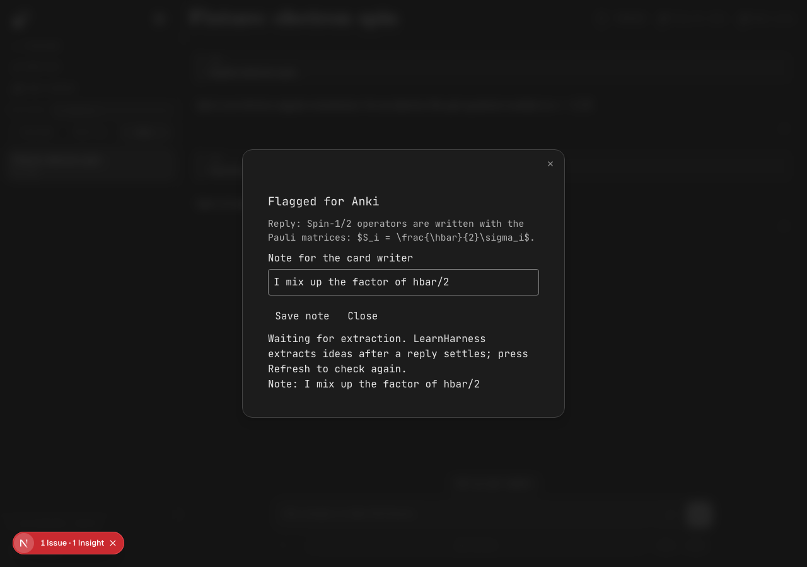
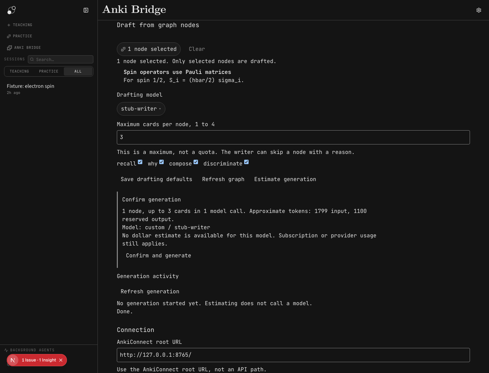
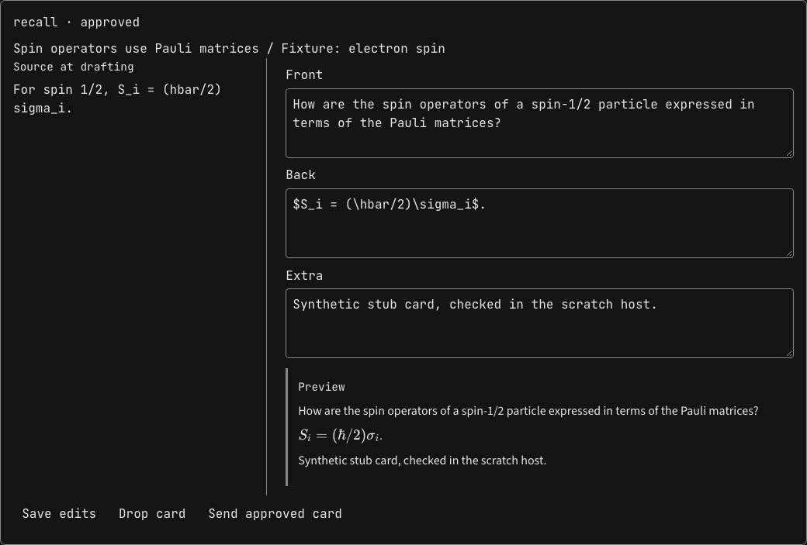
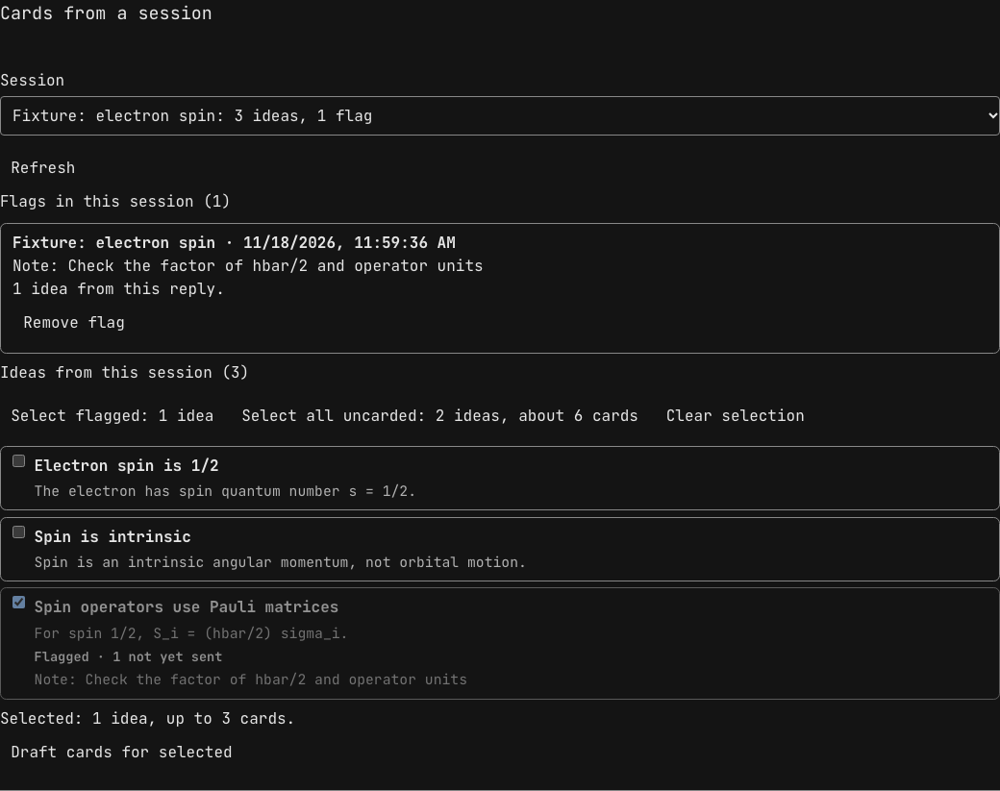

# 0.4.0 verification

Checked on 2026-11-18 against LearnHarness 0.6.1, after rebasing PR #4 onto merged 0.3.0, PR #5 at `e88f89d`. All runs used synthetic data. No real model or Anki calls were made.

## Automated

- `npm test`: 137 tests pass, none skipped. The merged 0.3.0 suite had 100 tests; 0.4.0 adds 37.
- `npx tsc --noEmit` passes.
- `npm run build` passes. The frontend bundle contains no `node:` imports.
- `src/anki/delivery.ts` is unchanged from merged 0.3.0. Its generation-aware writer fence, drop operation, recovery reporting and public generation fields are preserved.

The session tests cover:

- Teacher-prose selection, including delivered `send_to_user` and exclusion of calls from failed or aborted generations; latest-turn anchors across tool loops and unanswered learner messages.
- Flag validation, one-line notes, chat/message provenance matching, transcript order, overlapping flags and the 5,000-flag cap. Re-flagging updates rather than duplicates. An omitted note keeps it; an empty note clears it.
- A coverage fingerprint pinned to hashes computed by LearnHarness 0.6.1's own `messageFingerprint` source.
- State migration 1 → 2 → 3 and 2 → 3, preserving pairing, cards and generation settings. A separate integration test migrates an actual completed generation with an applied result and a generated card's source snapshot. Malformed generation, flag and card data, and future schemas, are refused without changing the file.
- Waiting → no new ideas → matched, persistence, refusal of invalid targets, and missing sessions/messages staying visible.
- Flag writes waiting behind delivery through the shared writer fence. Card counts distinguish the paired destination from another profile, and the per-node estimate reads saved generation settings.
- Top-bar actions, shortcut binding and disabled states; click-dialog notes; keyboard confirmation, auto-close and Undo only for a flag that press created.
- Session defaults, select-all-uncarded and refresh preserving manual ticks. Removing a flag clears its automatic ticks, and checkbox changes update Clear selection.
- Deleted sessions and messages with retained graph provenance, plus matched flags outside the session picker cap, stay visible and removable. Picker counts include selectable propositions only.
- Saved-note preservation and explicit clearing; failed or overlapping session loads cannot expose the wrong session's flow or retain a superseded error.
- Fresh graph metadata after session handoff. A pending, successful or failed reload cannot revive an old confirmation, including a click already queued before the handoff begins. No generation is started by those stale clicks.
- Session counts refresh after partial-send recovery.

`tests/session-integration.test.ts` connects the real frontend panels to the real backend through the offline fake host:

1. The session's Draft button reaches `draftingPanel.select` in display order. Selecting again clears an old estimate and never starts generation.
2. Saved card-cap changes update the session estimate without Refresh. Completed drafting updates session card counts through the draft panel's normal polling callback.
3. A flag note reaches both the saved writer input and the worker prompt. Editing it rejects an old preflight before any worker starts. Removing it removes the extra from the next writer input.
4. A schema-2 snapshot with a completed generation migrates without losing tasks, results or generated source snapshots.

## Sol review

GPT-6.1 Sol and GPT-6.2 Sol, both on high reasoning, each completed three review rounds and approved the same final behavior diff. The parent ran the checks above; reviewers performed static review and did not rerun tests. The final behavior diff matches the approved snapshot. Subsequent documentation edits do not change behavior.

Review fixes cover missing-session flags, fresh graph metadata, session-load races, note preservation, selection controls, proposition counts and partial-send count refresh. A further regression test caught a queued old confirmation generating for the previous selection; the fix clears its visible estimate before reload and checks the captured estimate again when confirmation executes.

Two nonblocking nits were deferred without behavior changes:

- S11: the note input stays editable while a flag write is pending. Its saved reply can overwrite text typed during that wait. Wait for the save to finish before editing again.
- S12: an extraction refresh timer can be dropped while a session operation is busy. Manual Refresh remains available.

The proposed removal of optional callback and test-cap seams was declined as unnecessary cleanup, with no demonstrated behavior bug.

## Scratch LearnHarness host

These browser checks predate the final review fixes and apply to head `89f649b`. Those fixes have the automated coverage above; the scratch host was not rerun afterward.

A clean export of the v0.6.1 tag ran under `next dev` with scratch `LH_DATA_DIR`, `LH_AUTH_FILE` and `HOME`, `LH_IGNORE_ENV_KEYS=1`, and no Claude CLI on its PATH. The scratch directory was `/tmp/a04i`; the host used port 3017. The installed frontend matched that head's built bundle byte-for-byte. Both host and stub were stopped after testing.

The graph started with two nodes anchored to the first reply of a synthetic teaching session. The second reply had no coverage entry or node. The plugin was installed through the local installer and enabled through the host.

### Session checks

All 17 browser checks passed with no page errors:

- Flag for Anki and Make cards appear in the teaching top bar. The settled reply can be flagged through the dialog with a note.
- The flag persists the saved transcript's message ID, confirming that frontend and backend IDs agree.
- The shortcut flags immediately and auto-closes its confirmation. Re-flagging keeps one flag and its note.
- Make cards opens the selected session, initially showing the flag as waiting.
- Appending a coverage entry without a node, then pressing Refresh, shows "found no new ideas".
- Appending a node anchored to the flagged reply, then pressing Refresh, shows a match. Only the flagged node starts ticked, its note appears, and select-all-uncarded reports three ideas and about six cards.

### Connected drafting checks

A loopback-only OpenAI-compatible stub on port 18819 was registered through the host's custom-provider route as a keyless `custom / stub-writer` model. It returned fixed `submit_result` cards and never forwarded requests. The final clean run passed nine more checks:

1. Make cards opens the matching session with Draft cards for selected enabled.
2. Saving a cap of three updates the session's estimate from six to nine cards without Refresh.
3. Draft cards for selected sends only the flagged node to the native draft panel. Estimating shows one node, up to three cards in one call. Neither selection nor estimation calls the stub.
4. Editing the flag note after estimating makes confirmation fail as stale, still without a stub request.
5. A fresh estimate and explicit confirmation produce exactly one stub request, for the selected flagged node. The request contains the updated note and uses the output allowance shown in the estimate. One draft arrives with a frozen source snapshot in schema 3.
6. Session card counts update automatically when generation finishes. The flagged node becomes carded, and select-all-uncarded now reports two ideas and about six cards.
7. Editing and saving the generated card works. Bulk approval requires confirmation, then leaves the card approved with no Anki note ID. No connection or send operation is called.
8. Flags, generation history, settings and the edited draft remain byte-identical across disable/re-enable. Activation makes no additional stub request.
9. No browser page errors occur.

The card and updated-count screenshots were captured after reopening the scratch host, without starting a stub or making any new model request. The screenshots use synthetic data and fixed stub cards. They show the workflow, not real model quality.

## Not verified

- A real teaching turn or real extraction. Coverage and graph lines were seeded or appended, so the run does not measure extraction timing or the number of ideas a real flagged reply yields.
- A real model inside the app. The stub checks integration, note forwarding and token allowances only. The earlier bench evidence remains separate.
- Sending a generated card to Anki. No Anki profile was used. The earlier 0.2.0 delivery checks still apply, but this run stops at explicit approval.
- Packaged Electron behaviour.
- Shortcut conflicts with other community plugins. The host resolves conflicts and core bindings win.

The dev server's server-side render of an existing chat page returned HTTP 500 in `components/chat.tsx`, "object is not extensible", with the plugin enabled and disabled. The browser client recovered. This host dev-mode issue did not produce browser page errors in the passing runs.
