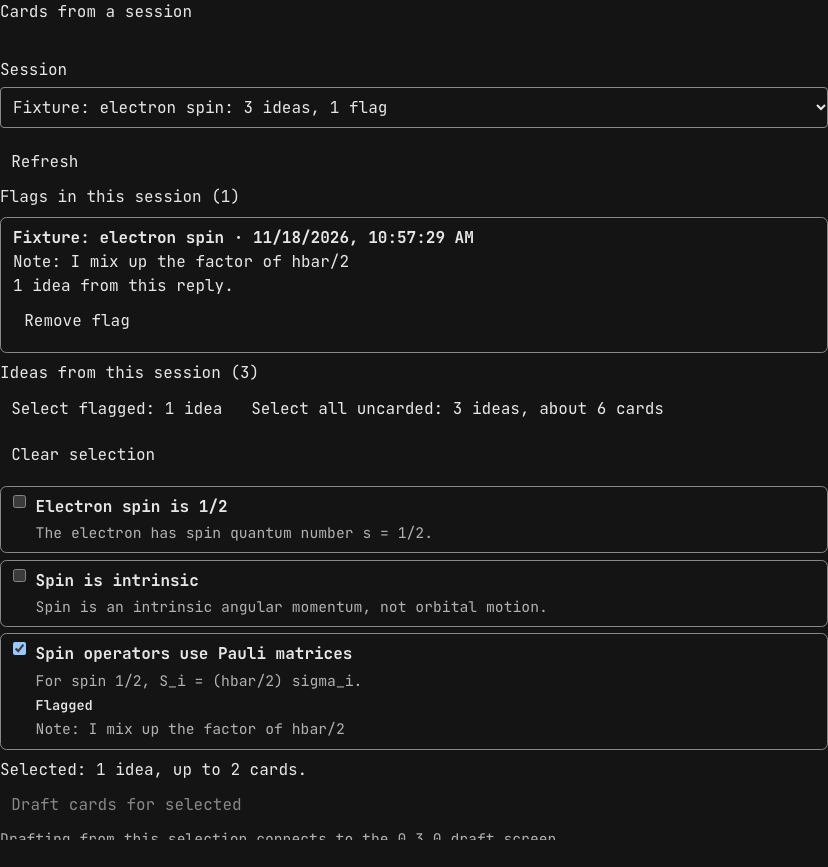

# 0.4.0 verification

Checked on 2026-11-18 against LearnHarness 0.6.1. No model calls, no Anki and no real LearnHarness data were used.

## Automated

- `npm test`: 101 tests pass, none skipped. 24 of them are new for 0.4.0, in `tests/session-flow.test.ts`, `tests/session-service.test.ts` and `tests/session-ui.test.ts`.
- `npm run typecheck` passes.
- `npm run build` passes. The frontend bundle contains no `node:` imports.

The new tests cover:

- teacher-prose selection, including `send_to_user` and calls from failed or aborted generations;
- the latest-turn rule across tool loops and unanswered learner messages;
- flag validation, note normalisation, matching by chat and non-empty message ID, and session node order;
- a coverage fingerprint pinned to hashes computed by LearnHarness 0.6.1's own `messageFingerprint` source;
- schema 1 → 2 migration without losing cards or settings, and refusal of a newer file without rewriting it;
- the waiting → no new ideas → matched sequence, and persistence across restart;
- updating a flag rather than duplicating it, the 5,000-flag cap, merging overlapping flags, and note keep/clear rules;
- refusal of learner, tool-only, unsaved, practice-session, missing and malformed targets;
- flags whose session or message disappears staying visible as `missing`;
- a flag waiting for an in-progress delivery operation instead of failing or losing either write;
- card counts that separate paired-destination sends from sends to another profile;
- top-bar placement, the shortcut binding, disabled states for streaming, unreconciled, practice and empty sessions;
- keyboard flag confirmation, auto-close, and Undo only for a flag that press created; the click dialog's note handling;
- Make cards opening the view on the session, default ticks, greying, "select all uncarded" and the draft handoff payload;
- refresh on extraction activity that keeps manual ticks and adds newly matched flagged nodes;
- unresolved flags from other sessions, Open session and Remove flag.

## Scratch LearnHarness host

A clean export of the v0.6.1 tag ran under `next dev` with scratch `LH_DATA_DIR`, `LH_AUTH_FILE` and `HOME`, `LH_IGNORE_ENV_KEYS=1`, and a `PATH` without the Claude CLI. The data directory held one synthetic teaching session (two learner and two teacher messages), two graph nodes anchored to the first reply, and a coverage entry for that reply only. The plugin was installed with `npm run install:local`.

Discovery listed Anki Bridge as disabled. After enabling it, a Playwright Chromium script passed 17 checks with no page errors:

1. Flag for Anki and Make cards appear in the teaching top bar, and Flag is enabled on the settled transcript.
2. The click dialog shows the latest reply. Flagging it with a note reports "waiting for extraction".
3. `state.json` holds one flag with the saved record's message ID and the note. This confirms the IDs in `view.messages` match the saved record.
4. `mod+shift+a` flags at once, shows the confirmation and closes it on its own. Re-flagging the same reply keeps one flag and keeps its note.
5. Make cards opens the view with the session selected and the flag shown as waiting.
6. After a coverage entry for the reply is appended without a node, Refresh shows "found no new ideas".
7. After a node anchored to the reply is appended, Refresh shows the flag as matched. Only that node is ticked, its note shows, and the button reads "Select all uncarded: 3 ideas, about 6 cards".

Over the host's HTTP plugin API, `sessions` and `sessionFlow` returned the seeded session and graph-derived nodes, and `flag` refused a learner message. Flags survived disabling and re-enabling the plugin.

These are screenshots from that run, with synthetic data.

## Not verified

- A real teaching turn and real extraction. The run used a hand-written transcript and graph lines, so it doesn't show how long extraction takes or how many nodes a real flagged reply yields.
- Drafting from the selection. It needs the 0.3.0 draft screen; the button is disabled on this branch.
- Packaged Electron behaviour.
- Shortcut conflicts with other community plugins. The host resolves conflicts and core bindings win.

The dev server's server-side render of an existing chat page returned HTTP 500 (`components/chat.tsx`, "object is not extensible") with the plugin enabled and with it disabled. The client recovered and rendered the page. This is a LearnHarness dev-mode issue, not part of this plugin.
